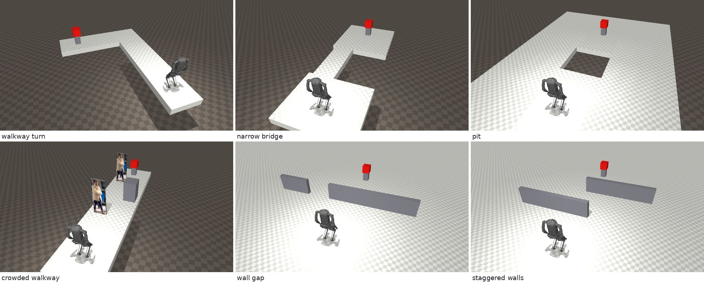

# kangaroo-systemone

Reactive, camera-driven navigation for PAL Robotics' [Kangaroo](https://github.com/pal-robotics/kangaroo_robot) biped in MuJoCo,
with [TypeSafe Jev](https://docs.typesafe.ai) or [CLM-8B](https://github.com/Contrastive-LM/CLM) making the decisions.
Walking is PAL's own RL policy; the model picks forward, left, right or backward once per move from what the head camera
sees.



**Results: [REPORT.md](REPORT.md).**

## Installation

Everything runs in Docker (ROS 2 Humble, MuJoCo, CPU only). The optional CLM server needs an NVIDIA GPU and the NVIDIA
Container Toolkit.

```bash
git clone https://github.com/OscarMrZ/kangaroo-systemone.git
cd kangaroo-systemone
docker compose build                  # add --profile clm to also build the CLM server
```

The image pins and builds `pal-robotics/kangaroo_robot`, `kangaroo_simulation` and `pal_policy_deployer`.

## Quick Start

Run one course with the rule-based baseline.

```bash
docker compose run --rm kangaroo bash -c "
  ros2 launch sim/kangaroo_systemone.launch.py scenario:=pit seed:=0 &
  sleep 30 && python3 -m kangaroo_systemone.navigator --brain heuristic --scenario pit --seed 0"
```

Use Jev instead.

```bash
export TYPESAFE_API_KEY=...   # https://console.typesafe.ai
docker compose run --rm kangaroo bash -c "
  ros2 launch sim/kangaroo_systemone.launch.py scenario:=pit seed:=0 &
  sleep 30 && python3 -m kangaroo_systemone.navigator --brain jev --scenario pit --seed 0"
```

Use CLM-8B: start its server on the GPU first (Qwen3-8B encoder + CLM head; set `OFFLOAD_GB=1.5` on 16 GB cards), then
run with `--brain clm_native` (questions written for CLM) or `--brain clm` (Jev's questions, for comparison).

```bash
docker compose --profile clm up -d clm
```

Watch the MuJoCo viewer (X11 or XWayland): prefix either command with `xhost +local: && VIEWER_DISPLAY=$DISPLAY`.

Courses: `walkway_turn`, `narrow_bridge`, `pit`, `crowded_walkway`, `wall_gap`, `staggered_walls`. The seed jitters the
start pose (±0.1 m, ±0.15 m, ±6°); seed 0 is the nominal start. An episode ends at the cube, at a fall, or after 90
moves (`--decisions`).

## Benchmark

Run every course with every decision maker (Jev, CLM naive, CLM native, rule) and seeds 0–4, each episode in a fresh
simulation (120 episodes, ~5 h; the CLM server must be up).

```bash
docker compose run --rm kangaroo python3 -m kangaroo_systemone.bench
docker compose run --rm kangaroo python3 -m kangaroo_systemone.bench --brains heuristic --scenarios pit --seeds 0
```

Results go to `results/<run>/`: `summary.md`, `episodes.csv`, and one `.jsonl` per episode with every scene, decision and raw Jev
answer. Regenerate the report figures from a run.

```bash
docker compose run --rm kangaroo python3 docs/figures.py results/<run>
```

## Layout

| Path | What |
| --- | --- |
| `sim/kangaroo_systemone.launch.py` | MuJoCo sim, introspection shim and PAL walking policy |
| `kangaroo_systemone/sim_setup.py` | D435 camera, course worlds and plugins, applied to the installed PAL packages |
| `kangaroo_systemone/scenarios.py` | courses |
| `kangaroo_systemone/perception.py` | RGB-D frame → scene description |
| `kangaroo_systemone/brains.py` | Jev's questions, CLM-native questions, policy in code, rule-based baseline |
| `docker/clm/` | CLM-8B server: vLLM Qwen3-8B encoder + `clm-serve` |
| `kangaroo_systemone/navigator.py` | perceive → decide → `/cmd_vel` loop, episode metrics |
| `kangaroo_systemone/bench.py` | benchmark runner |
| `kangaroo_systemone/introspection_shim.py` | ros2_control introspection topics for PAL's policy node on Humble |
| `docs/figures.py` | report figures |
