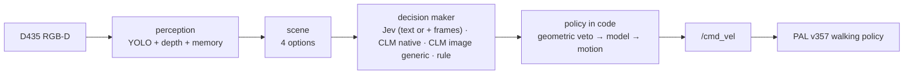
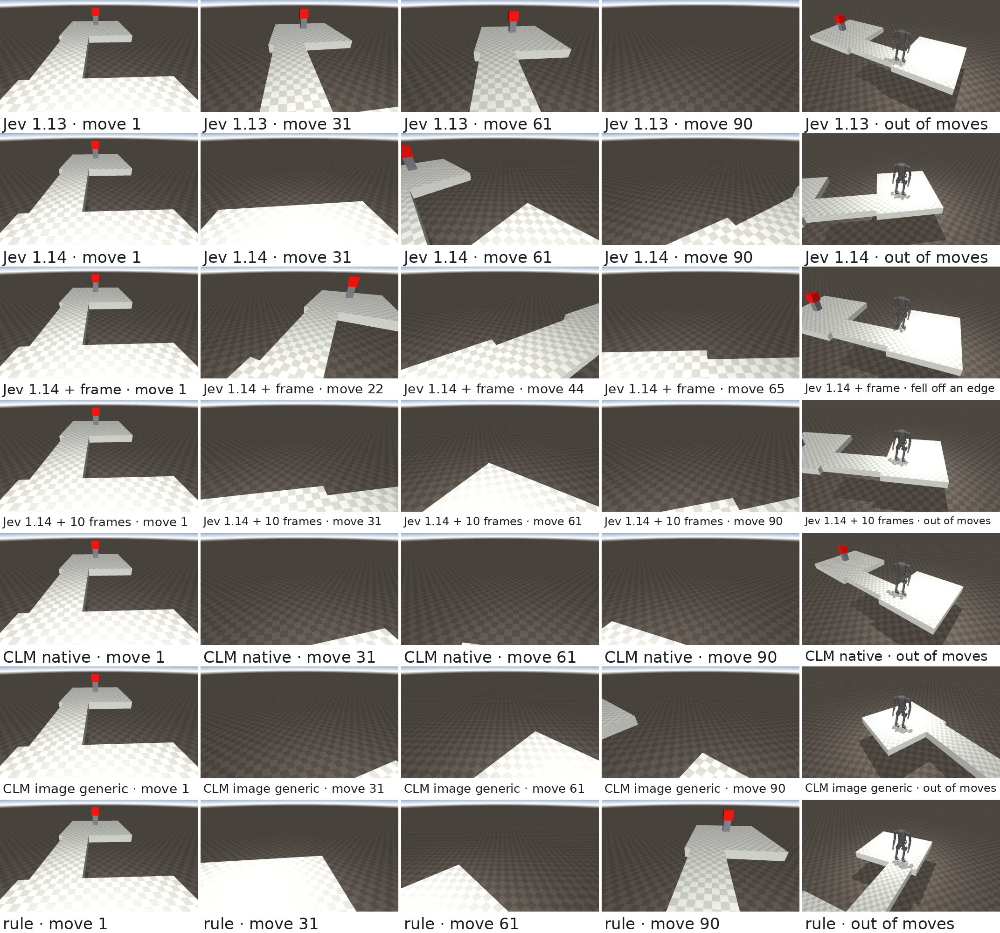

# Kangaroo × System One models: reactive navigation

Exploratory report · October 2026 · 210 episodes (6 courses × 7 decision makers × 5 seeds)


## Summary

- **Question.** Can a System One model, one that returns typed judgments rather than text, make the move-by-move
  decisions of a camera-driven reactive navigator on PAL Robotics' Kangaroo biped?
- **Setup.** Kangaroo (4dof arms) in MuJoCo, walking on PAL's own RL locomotion policy. A head RGB-D camera, four discrete
  motions, and a red goal cube that is in view from the start. No map, no planner, no pose for the decision maker. Seven
  decision makers see the same scene and obey the same safety margin in code (see [Decision makers](#decision-makers)):
  - TypeSafe Jev on text: **Jev 1.13** and **Jev 1.14**.
  - Jev 1.14 with head-camera images added to the same request: **Jev 1.14 + frame** (the current frame) and **Jev 1.14 +
    10 frames** (the last ten).
  - **CLM native**: CLM-8B with questions written for it.
  - **CLM image generic**: [kangaroo-clm](../kangaroo-clm)'s image CLM head, pre-trained on public scene and
    people-navigation data, then fine-tuned on robot decisions labelled by a planner; with its own state and questions.
  - A hand-written **rule**.
- **Result.** Three falls in 210 episodes, all by Jev with camera frames.

  | | Decision maker | progress, mean ± sd | cube reached | fell | decision latency, median |
  | --- | --- | --- | --- | --- | --- |
  | **Jev, text** | Jev 1.13 | 49 ± 25% | 4 / 30 | 0 | 0.23 s |
  | | Jev 1.14 | **58 ± 33%** | **8 / 30** | 0 | 0.22 s |
  | **Jev, text + images** | Jev 1.14 + frame | 53 ± 30% | 7 / 30 | 1 | 0.25 s |
  | | Jev 1.14 + 10 frames | 47 ± 25% | 3 / 30 | 2 | 0.34 s |
  | **CLM, text** | CLM native | 38 ± 24% | 2 / 30 | 0 | 4 ms (0.2 s uncached) |
  | **CLM, images** | CLM image generic | 51 ± 28% | 4 / 30 | 0 | 0.13 s |
  | **baseline** | rule | 48 ± 29% | 7 / 30 | 0 | – |

  - **Jev 1.14 on the unchanged text request is the best decision maker so far.** It gains 9 pp over Jev 1.13 (95% CI +1
    to +17) and 9 pp over the rule (CI −2 to +20), mostly from turning to search when the cube is lost.
  - **Camera frames made Jev 1.14 worse on the same starts.** One frame cost 5 pp (CI −10 to −1), the last ten 11 pp (CI
    −21 to −3). With frames it was more cautious, dithered more, and caused the only three falls.
  - **Jev 1.13 and the rule are level** (+1 pp, CI −9 to +10).
  - **CLM native** reaches 38%, 11 pp behind Jev 1.13 (CI +1 to +21). Asked Jev's questions unchanged, CLM-8B made 8%.
  - **CLM image generic** is level with the rule (+3 pp, CI −7 to +13) and with Jev 1.13. It was fine-tuned on these six
    courses, from the start poses of seeds 0–3; on the held-out seed 4 it makes 50%, against the rule's 55% and Jev 1.14's
    58%. Its pre-training carries over: on ten courses it never saw, the head already picks the planner's motion 55% of
    the time before any robot data, 58% after.
- **Lessons.**
  1. Safety has to be split from progress. A single "pick the action" question let Jev walk off every raised edge. A safety
     `Noul` and a progress `Score` per motion, with the margin enforced in code, removed the falls.
  2. The questions have to fit the model. CLM embeds the state and each answer separately, so Jev's eight questions,
     which share one long state and differ in one line, give it nothing to tell the motions apart: it rated "step
     backwards" best in every decision. One `Choice` whose options carry each motion's consequence in words works.
  3. Every decision maker ends up in the reactive local minimum: 55–80% of their moves are turns, with 18–30 left–right
     reversals per episode in front of walls and edges.
  4. Say what to do when the goal is lost. Jev 1.13 walks away once the cube is out of sight; Jev 1.14, on the same
     questions, mostly turns to search, and CLM native, whose wording says "the cube is out of sight", turns to search in
     672 of 674 such moves. CLM image generic walks on in 78% of such moves and ends 9 of its 10 open-floor episodes more
     than 9 m away.
  5. General pre-training gives an image CLM a head start: kangaroo-clm's generic head, fine-tuned on planner-labelled
     robot decisions, is level with the rule and Jev 1.13, and before fine-tuning it already agreed with the planner on
     courses it never saw almost as well as after.
  6. Images are not free information. Jev 1.14's camera frames made it more cautious and did not stop the dithering; a
     history of frames without a question that uses it adds tokens and latency, not memory. The newer model on the
     unchanged text request gained more than any added input.
  7. One episode per course is not enough. An earlier single-seed run had Jev ahead of the rule, 47% vs 33%; across five
     seeds that gap disappears.

## Setup

| Part | Choice |
| --- | --- |
| Robot and simulator | `kangaroo_simulation` pregenerated MJCF `floating_4dof_no-end-effector_fixed`, `mujoco_ros2_control`, ROS 2 Humble |
| Walking | `pal_policy_deployer` loco policy **v357** (4dof baseline, mjlab), `full_body_4dof` PD gains, 50 Hz |
| Camera | Idealized RealSense D435 on the torso colour frame: pinhole RGB-D, 87°×58°, 424×240, 30° down, 5 Hz |
| Perception | YOLO26n-seg (CPU) + depth geometry + red-colour mask, 20 s memory of edges, obstacles and the cube |
| Motions | forward 0.5 m/s · turn ±0.7 rad/s on the spot · backward −0.3 m/s; each lasts at most 1 s |



## Decision makers

All seven get the same scene from perception, and code applies the same geometric veto (a motion needs measured room),
so only the choice among the allowed motions differs. The registry name to run each with `bench --brains` is in brackets.
Jev without a version, in the sections on the first run, is Jev 1.13.

| Name | Model | Questions per move | Runs on |
| --- | --- | --- | --- |
| *Jev, text* | | | |
| **Jev 1.13** (`jev`) | TypeSafe Jev 1.13 (`jev-latest` at the time) | [Jev's questions](#jevs-questions): 8, a safety `Noul` + progress `Score` per motion | TypeSafe API |
| **Jev 1.14** (`jev@jev-1.14.0`) | TypeSafe Jev 1.14 (`jev-1.14.0`) | the same 8 | TypeSafe API |
| *Jev, text + images* | | | |
| **Jev 1.14 + frame** (`jev_multi`) | Jev 1.14, image input (experimental) | the same 8, with the current head-camera frame added to the state | TypeSafe API |
| **Jev 1.14 + 10 frames** (`jev_multi_10`) | Jev 1.14, image input (experimental) | the same 8, with the frames of the last 10 decisions and the motion taken after each | TypeSafe API |
| *CLM, text* | | | |
| **CLM native** (`clm_native`) | [CLM-8B](https://github.com/Contrastive-LM/CLM) v0.1 (Qwen3-8B encoder + CLM head) | [CLM-native questions](#clm-native-questions): 1 `Choice` among the allowed motions | local RTX 5060 Ti |
| *CLM, images* | | | |
| **CLM image generic** | kangaroo-clm's v2 G2+K_m head: Qwen3-VL-8B (FP8) encoder + a CLM head pre-trained on public scene questions and people navigating, then fine-tuned on planner-labelled Kangaroo episodes (with mirrored copies) and 40% replay of the general data | [kangaroo-clm's mission questions](#kangaroo-clms-mission-questions): frame + mission + tracker status, action `Choice` + 4 safety `Noul`s | local RTX 5060 Ti |
| *baseline* | | | |
| **rule** | none | hand-written: walk forward if the cube is within 15° ahead; else turn towards it if that way has 1.5 m of free run; else keep walking where it is open; if the cube is unknown, turn left to search | – |

## Experiment

**Episodes.** 6 courses × 7 decision makers × 5 seeds = 210 episodes, each in a fresh simulation, in two runs: Jev 1.13,
CLM native, CLM image generic and the rule first; the three Jev 1.14 decision makers four days later, on the same starts.

- **Seed:** jitters the start pose by up to ±0.1 m forward, ±0.15 m sideways and ±6° of heading; seed 0 is the nominal
  start, and the cube stays in view at every start. The simulation is not deterministic either (ROS timing), so the same
  seed does not replay exactly.
- **Start:** the walking policy takes over at about 8 s; driving starts at 15 s.
- **Loop:** perceive → decide → move for at most 1 s, repeated.
- **End:** an episode ends when the robot reaches the cube, falls, or uses up **90 moves**. The budget is in moves, not
  seconds, so a slower decision maker or a busy machine gets the same number of moves.

**Metrics.**

| Metric | Definition |
| --- | --- |
| reached | base within 0.9 m of the cube centre (standing in front of it) |
| progress | (start distance − closest distance) / (start distance − 0.9 m), clipped to 0–100%; 100% = reached |
| fell | base below 0.5 m; *fell off* if it ends below the deck |
| grazed | base within 0.3 m (the robot's footprint) of a wall, box or person |
| turn share, reversals | share of moves that are turns; a left directly after a right, or vice versa |

**Comparison.** Decision makers are paired on the same course and seed. The report gives the mean of the 30 paired
differences in progress with a 95% bootstrap confidence interval.

## Courses

Every course starts with the robot near the origin and the cube on a 0.5 m pedestal in view. Raised courses are deck tiles
over a floor 1.5 m below: stepping off is a fall that ends the episode. Walls are 0.8 m, below the camera, so the cube stays
visible over them.

| Course | What makes it hard |
| --- | --- |
| walkway turn | 1.4 m L-shaped walkway; the straight line to the cube crosses the drop |
| narrow bridge | 1 m bridge, offset to the left of the straight line |
| pit | 2×2 m hole between the robot and the cube |
| crowded walkway | 2 m walkway with two people and a block |
| wall gap | wall across the way, 1.2 m gap off to the left |
| staggered walls | weave right, then left |

What the robot's camera sees at the nominal start, with YOLO masks (the cube is found by colour, not by YOLO):


## Decision design

Perception does all the geometry. For each motion, perception looks along a robot-wide strip in the direction the robot
would face afterwards and measures three things: the distance to the nearest obstacle, the distance to where the floor
ends, and where the cube would then be.

```json
{
  "goal": {"visible": true, "distance_m": 4.6, "bearing_deg": 33},
  "options": {
    "forward":  {"path_clear_m": 4.0, "floor_ends_m": 4.0, "free_run_m": 4.0,
                 "goal_bearing_after_deg": 33},
    "left":     {"path_clear_m": 4.0, "floor_ends_m": 1.0, "free_run_m": 1.0,
                 "goal_bearing_after_deg": 5},
    "right":    {"path_clear_m": 4.0, "floor_ends_m": 1.0, "free_run_m": 1.0,
                 "goal_bearing_after_deg": 61},
    "backward": {"path_clear_m": 4.0, "floor_ends_m": 4.0, "free_run_m": 4.0}
  },
  "objects": [],
  "recent_actions": ["forward", "left"]
}
```

Code always applies the **geometric veto** first: a motion needs measured room, 0.8 m of free run to walk forward and
0.5 m to turn. Backward is allowed only to undo a step forward, since the camera cannot see behind. If nothing is
allowed, code turns towards the side with more room.

### Jev's questions

Used by all four Jev decision makers. The state is the scene above plus a short legend of its fields (~550 tokens); 8
questions in one request (TypeSafe's speculative fan-out): for each motion a `Noul`, "is it safe to …?", and a 4-level
`Score`, "how much would it help reach the red cube to …?". Then, in code:

1. **Model veto.** An allowed motion is dropped if its p(safe) is below 0.3 (people, odd objects).
2. **Progress.** The highest progress score wins.

### CLM-native questions

Used by **CLM native**. CLM embeds the state and each candidate answer separately and compares them, so everything that
tells the motions apart goes into the answers, and numbers become words. Safety stays entirely in code: only the allowed
motions are offered. One `Choice`, ~50 tokens of state:

```
state:    A walking robot is trying to reach a red cube. The cube is about 6 m away, straight ahead.
          A person is about 2 m away, straight ahead.
question: Which move gets the robot closer to the red cube, or helps it find the cube if it is out of sight?
options:  forward: Walk forward: a long stretch of open floor before something is in the way, and the cube would
                   then be straight ahead.
          left:    Turn left: a short stretch of open floor before the floor ends, and the cube would then be ahead
                   to the right.
          right:   Turn right: a short stretch of open floor before the floor ends, and the cube would then be ahead
                   to the left.
```

Free run becomes "open floor as far as it can see" (4 m), "a long stretch" (2–4 m), "a short stretch" (0.8–2 m) or
"right in front"; the cube's bearing becomes "straight ahead" (< 15°), "ahead to the left/right" (< 60°), "off to the
left/right" (< 120°) or "behind the robot". The motion with the highest probability wins.

### kangaroo-clm's mission questions

Used by **CLM image generic**, through kangaroo-clm's own `clm_nav` brain, unchanged. The state is the
head-camera frame plus a short legend and a tracker kept in code: the mission sentence ("Go to the red cube that stands
on a grey pedestal and stop in front of it."), whether the target is in view or where it was last seen and how many moves
ago, a status (stuck, dithering, long turning, budget), and the recent motions. No distances or detected objects: the
geometry comes from the image. The questions are one action `Choice` over the four motions and a safety `Noul` per
motion; code applies the same geometric veto, then the model's safety veto, then the most probable motion. The head was
trained on these questions, labelled by a planner that sees the true layout and pose.

### How the design got here

| Iteration | Courses | Outcome |
| --- | --- | --- |
| One `Choice` picks the motion; goal from the simulator pose | 5 flat courses, 1 seed | Jev reached 1 of 5, rule 4 of 5. Jev kept walking with an obstacle 0.9 m ahead and walked away from a goal behind it. |
| One `Choice`; goal found by the camera | 6 raised and wall courses, 1 seed | Jev walked off an edge on all 4 raised courses, its confidence rising to 0.98 as the edge closed in. |
| Fan-out of `Noul` + `Score` per motion, policy in code | same, 1 seed, 90 s | No falls; progress 47% vs 33%. |
| Same design, 5 seeds, 90 moves | same | No falls; Jev 49%, rule 48%. The single-seed lead was noise. |
| CLM-8B on Jev's questions | same | 8%: its answers barely depend on the scene. |
| CLM-native questions, chosen offline (below) | same | CLM 38%. |
| kangaroo-clm's image heads, own mission questions | same | 51% (pre-trained, then fine-tuned) and 54% (robot data only). |
| Jev 1.14; Jev 1.14 with camera frames | same | 58%; 53% with one frame, 47% with ten. |

## Results

### All decision makers

The first run had Jev 1.13, CLM native, CLM image generic and the rule; the second, four days later, the three Jev 1.14
decision makers, on the same 30 starts.

| | Decision maker | reached | fell | grazed | progress, mean ± sd | moves: forward / turns / backward | left–right reversals per episode | decision latency, median |
| --- | --- | --- | --- | --- | --- | --- | --- | --- |
| **Jev, text** | Jev 1.13 | 4 / 30 | 0 | 2 | 49 ± 25% | 30% / 66% / 3% | 17.8 | 0.23 s |
| | Jev 1.14 | **8 / 30** | 0 | 1 | **58 ± 33%** | 29% / 63% / 8% | 19.2 | 0.22 s |
| **Jev, text + images** | Jev 1.14 + frame | 7 / 30 | 1 | 0 | 53 ± 30% | 22% / 71% / 7% | 21.8 | 0.25 s |
| | Jev 1.14 + 10 frames | 3 / 30 | 2 | 2 | 47 ± 25% | 22% / 72% / 6% | 22.7 | 0.34 s |
| **CLM, text** | CLM native | 2 / 30 | 0 | 0 | 38 ± 24% | 24% / 76% / 0% | 30.2 | 4 ms (cached), 0.2 s (new) |
| **CLM, images** | CLM image generic | 4 / 30 | 0 | 2 | 51 ± 28% | 44% / 55% / 1% | 21.4 | 0.13 s |
| **baseline** | rule | 7 / 30 | 0 | 1 | 48 ± 29% | 19% / 80% / 0.5% | 22.1 | – |

Progress per course:

| Decision maker | walkway turn | narrow bridge | pit | crowded walkway | wall gap | staggered walls | all |
| --- | --- | --- | --- | --- | --- | --- | --- |
| *Jev, text* | | | | | | | |
| Jev 1.13 | 67 ± 27% (2) | 26 ± 6% | 81 ± 23% (2) | 31 ± 3% | 46 ± 4% | 43 ± 18% | 49 ± 25% (4) |
| Jev 1.14 | 94 ± 8% (2) | 20 ± 3% | **100 ± 0% (5)** | 31 ± 2% | 52 ± 14% | **50 ± 28% (1)** | **58 ± 33% (8)** |
| *Jev, text + images* | | | | | | | |
| Jev 1.14 + frame | 82 ± 15% (2) | 26 ± 6% | **100 ± 0% (5)** | 30 ± 3% | 45 ± 2% | 34 ± 15% | 53 ± 30% (7) |
| Jev 1.14 + 10 frames | 78 ± 18% (1) | 23 ± 1% | 61 ± 32% (2) | 30 ± 3% | 45 ± 2% | 42 ± 19% | 47 ± 25% (3) |
| *CLM, text* | | | | | | | |
| CLM native | 90 ± 13% (2) | 21 ± 3% | 26 ± 1% | 32 ± 3% | 38 ± 3% | 21 ± 2% | 38 ± 24% (2) |
| *CLM, images* | | | | | | | |
| CLM image generic | **95 ± 9% (3)** | 21 ± 2% | 76 ± 23% (1) | **45 ± 10%** | 45 ± 2% | 28 ± 2% | 51 ± 28% (4) |
| *baseline* | | | | | | | |
| rule | 75 ± 32% (3) | **28 ± 7%** | 62 ± 31% (2) | 32 ± 3% | **67 ± 27% (2)** | 27 ± 4% | 48 ± 29% (7) |

In brackets: cubes reached out of 5, where any.

Progress is the mean ± sd over 5 seeds. Paired differences in progress over the 30 (course, seed) pairs:

| Pair | Mean difference (95% CI) | First ahead / behind / tied |
| --- | --- | --- |
| Jev 1.14 − Jev 1.13 | +9 pp (+1 to +17) | 14 / 11 / 5 |
| Jev 1.14 − rule | +9 pp (−2 to +20) | 12 / 9 / 9 |
| Jev 1.14 − CLM image generic | +6 pp (−1 to +14) | 16 / 9 / 5 |
| Jev 1.14 − CLM native | +20 pp (+10 to +31) | 19 / 6 / 5 |
| Jev 1.14 + frame − Jev 1.14 | −5 pp (−10 to −1) | 6 / 11 / 13 |
| Jev 1.14 + 10 frames − Jev 1.14 | −11 pp (−21 to −3) | 10 / 12 / 8 |
| Jev 1.14 + 10 frames − Jev 1.14 + frame | −6 pp (−15 to +3) | 11 / 13 / 6 |
| Jev 1.14 + frame − rule | +4 pp (−6 to +15) | 13 / 13 / 4 |
| Jev 1.14 + 10 frames − rule | −2 pp (−14 to +10) | 10 / 15 / 5 |
| Jev 1.13 − rule | +1 pp (−9 to +10) | 14 / 10 / 6 |
| Jev 1.13 − CLM native | +11 pp (+1 to +21) | 22 / 5 / 3 |
| CLM native − rule | −10 pp (−20 to −1) | 5 / 22 / 3 |
| CLM image generic − rule | +3 pp (−7 to +13) | 13 / 12 / 5 |
| CLM image generic − Jev 1.13 | +2 pp (−7 to +12) | 11 / 15 / 4 |
| CLM image generic − CLM native | +13 pp (+7 to +21) | 23 / 4 / 3 |


- **Single episodes swing widely.** Start changes of at most 0.15 m and 6° move one pair by up to 69 pp (pit, seed 3), and
  on the walkway each decision maker wins some seeds outright. Only the pooled results and the large per-course gaps are
  worth reading.
- **The narrow bridge stalls everyone** at 20–28%; the crowded walkway stalls all but CLM image generic (45%). Here the course
  limits the outcome, not the decision maker.

### Jev 1.13 and the rule

- **Same average, different style.** Jev walks forward more (30% of moves vs 19%) and reverses direction less. That pays
  off where the open way bends round an obstacle towards the cube, as on the pit (+19 pp) and staggered walls (+15 pp).
- **The rule's stubbornness pays off at the wall gap** (−21 pp). "Keep walking where it is open" carries it along the
  wall to the gap on 2 of 5 seeds. Jev either turns back towards the cube behind the wall or, once it has lost the cube,
  walks away (see [Failure modes](#failure-modes)); it never gets through.

Best case for Jev, the pit (seed 3): Jev 1.13 walks round the hole and reaches the cube in 68 moves; so do Jev 1.14 (62),
Jev 1.14 + frame (45) and Jev 1.14 + 10 frames (64). CLM image generic runs out of moves, CLM native turns back and forth
at the rim, and the rule spends its moves at the rim. Frames are re-rendered from the logged base pose (joints at the start posture), with
YOLO masks:


### Jev 1.14, with and without camera frames

Jev also accepts images, still experimentally: a request opts in with the `TypeSafe-Danger-Zone-Images: true` header and
puts the images into the state, as TypeSafe's image docs describe for Dreamer-style frame histories (`frames[].frame`, oldest
first). Three decision makers on **Jev 1.14** (`jev-1.14.0`, the current preview; `jev-latest` is 1.13) ran
on the same 30 starts, in one run, one episode at a time:

| | **Jev 1.14** (`jev@jev-1.14.0`) | **Jev 1.14 + frame** (`jev_multi`) | **Jev 1.14 + 10 frames** (`jev_multi_10`) |
| --- | --- | --- | --- |
| state | the legend and the scene, as for Jev | the same, plus `frames`: the current head-camera frame | the same, plus `frames`: the frames of the last 10 decisions, each with the motion taken after it |
| questions | Jev's 8 | the same 8 | the same 8 |
| input tokens per decision | 2,300 | 2,790 | 6,320 |
| decision latency, median / p95 | 0.22 / 0.31 s | 0.25 / 0.40 s | 0.34 / 0.63 s |

A frame is the 424×240 colour image, upscaled to 495×280 (the API takes no side below 280 px) and sent as JPEG, about 490
input tokens. Each `frames` entry has `moves_ago` (0 for the current frame), `frame`, and `action_after` (the motion
taken after it; none for the current one). One extra legend line explains these fields. The questions do not mention
the frames. Jev 1.14 without frames is the control: the three differ only in the frames.

Their per-course results are in [All decision makers](#all-decision-makers).

- **The frames did not help.** Same model, same starts:
  - One frame: −5 pp against the text-only request (95% CI −10 to −1). Ahead in 6 pairs, behind in 11, tied in 13.
  - Ten frames: −11 pp (CI −21 to −3).
  - Ten frames against one: −6 pp (CI −15 to +3).
- **Jev 1.14 without frames is the best decision maker so far.**
  - Score: 58%, and 8 cubes reached.
  - Against Jev 1.13 (first run): +9 pp (CI +1 to +17).
  - Against the rule: +9 pp (CI −2 to +20).
  - None of its episodes went more than 9 m from the cube (Jev 1.13: 5).
  - The gain is in the lost cube. With the cube neither visible nor remembered, 1.14 turns on 72% of those moves (1.13: 43%), which is the search the rule does. Nothing in the request changed.
  - The 1.13 episodes ran under heavier load (two at a time; see [Limitations](#limitations)), but the move budget makes timing irrelevant to the score.
- **Frames make Jev more cautious, not better informed.**
  - Without room to walk forward, median p(safe) falls from 0.37 (text) to 0.27 (one frame) and 0.18 (ten frames). The share called safe drops from 6% to 1% (1.13: 29%).
  - With 1.2 m or more of measured free run ahead, the frames call the step unsafe (p < 0.5) in 6% of decisions, against 1% for text.
  - The semantic veto (p < 0.3) blocked such a forward step 34 times for Jev 1.14 + frame.
  - Forward falls from 29% of all moves (text) to 22% (one and ten frames).
  - With the cube within 15° ahead and room to walk, the share of forward moves drops from 97% to 89% (one frame) and 94% (ten frames). The forward progress score's median drops from 2.60 to 2.17.
- **Memory did not stop the dithering.**
  - Left–right reversals per episode: 19.2 (text), 21.8 (one frame), 22.7 (ten frames). Turns: 63%, 71% and 72% of moves.
  - The frames show the model which turns it just made, but the questions still judge each motion on its own, and none asks it to commit to one side.
  - With memory the cube is lost more often: 26%, 34% and 42% of moves.
- **Three falls, the first in this benchmark** (all off an edge):
  - Jev 1.14 + frame on the narrow bridge, seed 0.
  - Ten frames on the pit, seed 0, and on the walkway turn, seed 4.

  In all three, the code veto allowed the fatal move: it had at least 1.0 m of measured free run (twice a turn on the spot, once a forward step). Each came after several moves within 0.6 m of an edge in at least one direction. There, the floor right under the feet is out of the camera's view, and only the 20 s memory knows it. The text-only Jev (60 episodes) and the rule never fell. Three falls in 60 episodes is a warning sign, too few to measure a rate.
  
  Narrow bridge, seed 0: Jev 1.14 + frame turns back and forth at the bridge's start and goes over the edge on move 65.

  

- **Cost and reliability.**
  - Each frame adds about 490 input tokens, all counted in `usage.input_tokens`. One frame makes 2,790 tokens per decision; ten make 6,320, 2.7 times the text request.
  - Ten frames add 0.12 s at the median and 0.32 s at p95.
  - No API errors in 7,453 requests.
  - The three agreed with the rule on 59% (text), 58% (one frame) and 53% (ten frames) of moves.

### CLM native

Asked Jev's eight questions unchanged, CLM-8B answers without looking at the scene: across the four motions its p(safe)
differs by 0.02 (median; Jev 0.52), and it rates "step backwards" best in every decision (8% progress). For CLM each of
the 8 questions is the same ~550-token scene with one line naming the motion, which hardly moves its embedding. So CLM
gets its own questions.

**Choosing the native questions offline.** Before any closed-loop run, CLM answered candidate formulations on 213 scenes
logged in Jev's episodes (those with at least one allowed motion). Jev answered the same CLM-native questions as a
control: it shows how much of the decision the wording still carries.

| Decision maker and questions | agrees with the rule | agrees with Jev's own choice | left / right | latency |
| --- | --- | --- | --- | --- |
| random among the allowed motions | 43% | – | – | – |
| CLM, Jev's 8 questions | 38% | 45% | right-heavy | 1.6 s |
| CLM, a `Noul` per motion, outcome in the question | 54% | 53% | 55 / 100 | 0.39 s |
| **CLM, one `Choice`, outcomes as options (CLM native)** | **60%** | 53% | 85 / 75 | 0.20 s |
| Jev, the same `Choice` (control) | 64% | 73% | 51 / 74 | 0.22 s |
| Jev, the same `Noul`s (control) | 67% | 62% | 67 / 76 | 0.22 s |

The `Choice` won and went into the closed loop.

**CLM native in the closed loop:**

- **It drives.** 38% against 8% with Jev's questions (ahead in all 30 pairs). On the walkway turn it makes 90% (2 cubes),
  close to the best, and on the crowded walkway it is level with Jev and the rule.
- **It dithers most.** 30 left–right reversals per episode (pit: 46). The words make the two turns look alike: in 174 of
  the 419 pit decisions where both turns were allowed they describe the same room, and with the cube roughly ahead the
  two options are mirror images ("Turn left: a short stretch of open floor before the floor ends, and the cube would then
  be ahead to the right" against the same with left and right swapped). Nothing in them separates the turns, so it
  alternates. Around the pit it is 55 pp behind Jev 1.13.
- **It searches when the cube is lost.** In 674 moves (26%) the cube was neither visible nor remembered; CLM native
  turned on the spot in 672 of them and never walked away.
- **It is fast because the words repeat.** The same situation in words recurs, so CLM's embedding cache answers 58% of
  its decisions in 2–4 ms; a new situation takes about 0.2 s on the 16 GB card.

### CLM image generic

**CLM image generic** is [kangaroo-clm](../kangaroo-clm)'s G2+K_m head: a frozen Qwen3-VL-8B (FP8) encoder and a CLM head
first pre-trained on 97k rows of public data, then fine-tuned on Kangaroo episodes with 40% of that data replayed. The
pre-training mixes general scene questions with navigation decisions of people and robots: EgoWalk (city walking with
language goals: which way the walked path goes 2 m ahead), MuSoHu (walking through crowds, and whether a person is in
the way), SocialNav-SUB (robot clips in crowds, with human labels) and SAT (synthetic questions such as which way to turn
to face an object). The robot labels come from a planner that sees the
true layout and pose (not from the rule); every episode is also mirrored (frame flipped, left and right swapped) to remove
a left-turning bias. The state carries the frame, the mission and a tracker instead of perception's numbers (see
[kangaroo-clm's mission questions](#kangaroo-clms-mission-questions)).

- **It is level with the rule and Jev 1.13.** 51% of the way against 48% and 49% (+3 pp, CI −7 to +13; +2 pp, CI −7 to
  +12), 13 pp ahead of CLM native (CI +7 to +21) and 6 pp behind Jev 1.14 (CI −1 to +14). It reaches 4 cubes. It is the
  best of all on the walkway turn (95%) and the crowded walkway (45%), and weakest on the walls.
- **It drives forward.** 44% of its moves are forward, more than any other decision maker, and it turns least (55%,
  21 reversals per episode). That helps on the walkways and hurts on the walls.
- **It walks away when the cube is lost.** In 780 moves (29%) the cube was neither visible nor remembered; it walked
  forward in 607 of them. 9 of its 10 open-floor episodes (wall gap, staggered walls) ended more than 9 m from the cube.
  Its mission tracker says where the cube was last seen, but the head was not taught to search.
- **Its fine-tuning saw these courses.** The robot episodes come from these six courses (and ten more), from the start
  poses of seeds 0–3; only seed 4 was held out. On seed 4 it makes 50% (no cube) against Jev 1.13's 57% (1), Jev 1.14's
  58% (1) and the rule's 55% (2), on 6 episodes each.
- **The pre-training carries over.** In kangaroo-clm's offline test on ten courses it never trained on (`holdout_new`
  fold), the pre-trained head picks the planner's motion 55% of the time before any robot data and 58% after fine-tuning,
  level with a head trained on robot data alone (58%, which starts from nothing). It also keeps its general skills: 68%
  on public scene questions and 69% on navigation evaluations after fine-tuning.
- **Against the robot-only head.** kangaroo-clm's K-nav_m, the same recipe without pre-training or replay, made 54% here
  (7 cubes), 3 pp more (CI −4 to +10). It turns much more (82% of moves), searches when the cube is lost, and never
  walked away; it was trained only on these sim decisions.
- **It grazes.** Two grazes on the crowded walkway, up to 0.09 m inside the 0.3 m footprint margin. No falls.
- **It answers in 0.13 s** with the frame, on the same 16 GB card.

## Model judgments


These are the safety answers for walking forward, against the free run perception measured. Jev 1.13's follow the
measured room only roughly: with room to walk, the median p(safe) is 0.91; without it, 0.41, and 29% of forward steps
without room are still called safe. Jev 1.14 separates the two better (6% called safe without room); with camera frames
it calls fewer steps safe on both sides of the margin (see [Jev 1.14](#jev-114-with-and-without-camera-frames)). CLM
image generic judges safety from the frame alone, without perception's distances, and calls every forward step without
measured room safe (median 0.88). The margin belongs in code; a model's safety answer is useful as an extra veto, not as
the only one.


- **Jev 1.13 and 1.14:** one decision costs about 2,300 input tokens (8 questions; the state is read once), about
  $0.0001 at $0.042 per million tokens. No API errors in 2,615 (1.13) and 2,498 (1.14) requests. Jev 1.13 chose the
  same motion as the rule on 71% of moves, Jev 1.14 on 59%.
- **Jev 1.14 + frame / + 10 frames:** about 490 tokens per frame; 0.25 s median with one frame, 0.34 s with ten (see
  [Jev 1.14](#jev-114-with-and-without-camera-frames)).
- **CLM native:** one state of ~50 tokens and 2–4 short options per move: 0.2 s for a new situation on a 16 GB RTX 5060
  Ti, 2–4 ms when the same situation in words recurs (58% of moves). No errors; it chose the rule's motion on 58% of
  moves.
- **CLM image generic:** 0.13 s median with the frame (5 questions per move), on the same card. No errors in 2,662
  requests; it chose the rule's motion on 57% of moves.

## Failure modes

- **Dithering (all).** Turns are 63–82% of all moves, with 18–30 left–right reversals per episode. Near a wall or an
  edge the veto blocks forward, each turn looks best on its own, and nothing records which side was already tried. CLM
  native dithers most (see [CLM native](#clm-native)); ten frames of history did not help Jev.
- **Walking away (Jev 1.13).** In 5 of Jev 1.13's 10 open-floor episodes (wall gap, staggered walls) the robot went more
  than 9 m from the cube; the rule never did. In each case the cube was out of view, and usually out of the 20 s memory too.
  The likely cause: Jev's progress `Score` has no level for "cube unknown", so every free step forward rates as progress.
  The rule turns on the spot to search instead, and so does CLM native, whose wording says "the cube is out of sight".
  Jev 1.14 never did, on the same questions: with the cube lost it turns on 72% of moves (Jev 1.13: 43%). CLM image
  generic did in 9 of 10 (see [CLM image generic](#clm-image-generic)).
  Wall gap, seed 0: Jev loses the cube behind the wall and walks off; the rule follows the wall to the gap.

  
- **Narrow passages (all).** The bridge is offset from the robot's line, so getting onto it takes a sidestep: turn, walk,
  turn back. Facing the cube, forward runs into the platform edge within 0.8 m and is vetoed. Facing the bridge, no single
  move improves the view of the cube. No decision maker ever lined up with the bridge.
- **Falls with frames.** Jev with camera frames fell off an edge three times in 60 episodes, after dithering close to
  it; the veto had allowed each fatal move (see [Jev with camera frames](#jev-114-with-and-without-camera-frames)).
- **Grazes.** Eight episodes came at most 0.09 m inside the 0.3 m footprint margin: Jev 1.13 twice on the staggered
  walls, Jev 1.14 once on the wall gap, Jev 1.14 + 10 frames twice (crowded walkway, staggered walls), CLM image
  generic twice and the rule once on the crowded walkway. The base never came closer than 0.21 m to an obstacle.
- **Fallback turn.** When no motion is allowed, code turns towards the side with more room, without asking the model. In
  this benchmark it never caused a fall, but kangaroo-clm's image heads fell off an edge after such a turn in its own
  benchmark: standing
  still or stepping back would be safer.
- **YOLO false positives.** It labels the deck "bed" and a wall end "umbrella" in some frames, and these labels go to Jev
  unchanged. Distances come from depth, so a wrong label can only sway the models' judgments, not the veto.

## Limitations

- Five seeds per course and decision maker, and the seed only jitters the start pose. Per-course spreads are wide (up to
  ±32 pp), so only the pooled comparison and the large per-course gaps carry weight.
- Jev 1.13 and rule episodes ran two at a time, so perception took 0.1–2.2 s per frame (mean 0.75 s) instead of ~0.13 s. The move budget
  keeps the comparison fair, but the scene a move acts on can be up to about a second old.
- Idealized sensing: noise-free pinhole depth, and the simulator's base pose stands in for odometry. Perception uses the
  pose only to keep remembered points in place; the decision makers never see it.
- Fixed velocities and four motions; the walking policy (v357) turns at ~28°/s on the spot.
- The CLM native episodes ran one at a time, after the Jev 1.13 and rule episodes; perception was faster (0.14–0.16 s per
  frame). The move budget makes timing irrelevant to the comparison.
- The Jev 1.14 run came four days after the main run, one episode at a time (perception 0.12–0.13 s per frame). Its
  three decision makers share conditions; comparisons with the first run's (Jev 1.13, CLM, the rule) cross runs. Jev's image input is experimental (TypeSafe's "danger zone" header), and the
  frames were upscaled from 424×240 to meet the API's 280 px minimum.
- 16 episodes were restarted because the robot fell during the walking-policy handover, before the first move: 1 Jev
  1.13, 0 Jev 1.14, 2 Jev 1.14 + frame, 5 Jev 1.14 + 10 frames, 3 CLM native, 1 CLM image generic, 4 rule. One CLM native
  episode fell twice there and was run again.
- CLM image generic was fine-tuned on these six courses from the start poses of seeds 0–3 (kangaroo-clm's `all_courses`
  fold holds out seeds 4 and 9), so seeds 0–3 are in-distribution for it and only seed 4 is held out. Its episodes ran
  through kangaroo-clm's own benchmark loop (`kangaroo_clm.bench`), which calls this repo's episode loop, start poses
  and metrics unchanged.
- The CLM-native wording was chosen on 213 logged scenes against agreement with the rule and with Jev, not tuned in the
  closed loop. Its word bands are coarse by design; finer bands would separate the turns better but do more of the
  reasoning in code.

## Next steps

- **Lost cube.** Give the progress question an explicit answer for "cube neither visible nor remembered" (turn to search),
  or ask a separate `Noul` "is the cube's location known?" and search in code.
- **Commitment.** Ask a `Noul` "is the robot going back and forth without progress?" and keep a remembered turn direction
  in code until a long free run opens.
- **Floor view.** Give perception a wider view of the floor (a second camera or a lower tilt), so narrow passages are
  measured earlier.
- **Frames.** Ask a question that only the frames can answer (an edge or obstacle the depth misses, or "has the robot
  been here in the last moves?"), instead of adding them to questions that the scene already answers.
- **Variation.** Vary more than the start pose: course geometry, lighting, people's positions.
- **CLM image generic.** Run kangaroo-clm's `holdout_new` head, fine-tuned without these six courses, in this closed loop:
  the honest test of how far the pre-training carries. Teach it to search when the cube is lost (planner labels for
  lost-target situations, or a tracker status it acts on).
- **CLM native.** Break the mirror symmetry of the two turns (say which turn faces the cube more directly, or keep a
  remembered turn direction in code), and fine-tune a CLM head on these questions (CLM's `train/finetune.py --task choice`).

## Reproduce

```bash
docker compose --profile clm build
export TYPESAFE_API_KEY=...
OFFLOAD_GB=1.5 docker compose --profile clm up -d clm    # CLM-8B on the GPU; OFFLOAD_GB=0 on cards with 24 GB or more
docker compose run --rm kangaroo python3 -m kangaroo_systemone.bench \
  --brains jev jev@jev-1.14.0 jev_multi jev_multi_10 clm_native heuristic    # ~9 h, writes results/<run>/
```

`jev` runs `jev-latest`, which was Jev 1.13 for the first run. CLM image generic runs through kangaroo-clm's benchmark
(`clm_nav` there), with `clm-serve --state-chat --ckpt runs/gk_nav_m/all_courses/best_head.pt` on the host:

```bash
docker run --rm --network host -v $PWD:/kangaroo_systemone:ro -v <kangaroo-clm>:/kangaroo_clm:ro -v <clm-image>/src:/clm_src:ro \
  -e PYTHONPATH=/clm_src:/kangaroo_systemone:/kangaroo_clm --entrypoint /entrypoint.sh kangaroo-systemone \
  python3 -m kangaroo_clm.bench --brains clm_nav --model clm-latest --seeds 0-4 \
  --courses walkway_turn narrow_bridge pit crowded_walkway wall_gap staggered_walls
```

Comparison and figures over several runs (the first run that has a decision maker provides it):

```bash
docker compose run --rm kangaroo python3 -m kangaroo_systemone.bench --compare results/<run> ...
docker compose run --rm kangaroo python3 docs/figures.py results/<run> ... --no-photos --films pit:3 wall_gap:0 narrow_bridge:0 \
  --brains jev jev@jev-1.14.0 jev_multi jev_multi_10 clm_native clm_image_generic heuristic \
  --labels "jev=Jev 1.13" "jev@jev-1.14.0=Jev 1.14" "jev_multi=Jev 1.14 + frame" "jev_multi_10=Jev 1.14 + 10 frames" \
  "clm_image_generic=CLM image generic"
```

`results/<run>/summary.md` holds the tables above; each episode's `.jsonl` file holds every scene, decision and raw model
answer.

## Integration notes

Upstream code is pinned and not modified; `kangaroo_systemone/sim_setup.py` adapts the installed packages at launch.

- **Camera.** The MJCF has the RealSense frames but no camera. One is added on `torso_front_up_rgbd_camera_color_frame`
  and published by the `mujoco_ros2_control` CameraPlugin.
- **Start pose.** The robot always spawns at the world origin, so for a seed the course itself is placed around it. All
  logs and metrics are in the course frame.
- **Humble.**
  - `kang_mjlab_node` reads robot state from ros2_control's pal_statistics introspection topics, which only exist from
    Jazzy on. `kangaroo_systemone/introspection_shim.py` rebuilds them from `/joint_states` and the torso IMU, at 50 Hz sim
    time. It starts only once the RL controller is active; starting earlier knocks the robot over at the handover.
  - Humble's controller_manager also needs `~/robot_description` remapped to `/robot_description`.
- **Policies.**
  - Lower-body model: the launch default (v315) balances but never steps, also in plain MuJoCo on pal_mjlab's training
    XML. The newer forward/backward policies walk.
  - 4dof model: v357 was the best all-round policy in a MuJoCo sweep of v265, v352–v357 and v700.
- **CLM.** The `clm` service runs vLLM (Qwen3-8B, last-token pooling, bf16) and `clm-serve`, pinned to CLM commit
  `d5f9ef0`. `kangaroo_systemone/brains.py` builds Jev's questions with either SDK's `Noul` and `Score`, so any
  TypeSafe-compatible endpoint can answer them; `ClmNativeBrain` holds the CLM-native questions. Every decision maker
  is called with the scene and the camera frame.
- **Jev images.** `typesafe-sdk[pil]` 0.7.5 uploads `Image` objects found anywhere in the state; frame requests add the
  `TypeSafe-Danger-Zone-Images: true` header.
- **Perception.** The floor plane is fitted to the bottom of every frame. Without the fit, a few degrees of torso pitch
  turn distant floor into phantom obstacles or edges.

## Credits

[PAL Robotics](https://github.com/pal-robotics) (`kangaroo_robot`, `kangaroo_simulation`, `pal_policy_deployer`, `pal_mjlab`),
[mujoco_ros2_control](https://github.com/ros-controls/mujoco_ros2_control), [Ultralytics YOLO](https://github.com/ultralytics/ultralytics)
(the person billboards are a crop of its `bus.jpg` sample, AGPL-3.0), [TypeSafe](https://docs.typesafe.ai),
[Contrastive-LM CLM](https://github.com/Contrastive-LM/CLM) (Apache-2.0), [vLLM](https://github.com/vllm-project/vllm),
[kangaroo-clm](../kangaroo-clm) (the image CLM head and its serving setup), [Qwen3-VL](https://github.com/QwenLM/Qwen3-VL).
