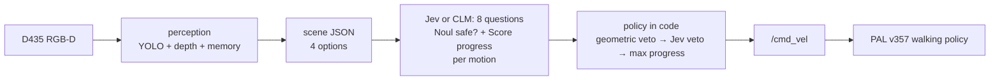

# Kangaroo × Jev: reactive navigation with System One models

Exploratory report · October 2026 · 90 episodes (6 courses × 3 decision makers × 5 seeds)


## Summary

- **Question.** Can [TypeSafe Jev](https://docs.typesafe.ai), a System One model that returns typed judgments rather than text,
  make the move-by-move decisions of a camera-driven reactive navigator on PAL Robotics' Kangaroo biped?
- **Setup.** Kangaroo (4dof arms) in MuJoCo, walking on PAL's own RL locomotion policy. A head RGB-D camera, four discrete
  motions, and a red goal cube that is in view from the start. No map, no planner, no pose for the decision maker. Jev is
  compared against a short hand-written rule that sees the same scene and obeys the same safety margin, and against
  [CLM-8B](https://github.com/Contrastive-LM/CLM), a contrastive System One model with a TypeSafe-compatible API, asked
  the same questions.
- **Result.** No falls in 90 episodes. Jev and the rule make the same progress: **49% vs 48%** of the way to the cube on
  average, a paired difference of +1 pp (95% CI −9 to +10 pp). The rule reached the cube in 7 of 30 episodes, Jev in 4.
  The differences are per course: Jev is ahead around the pit (+19 pp) and the staggered walls (+15 pp), and the rule is
  ahead at the wall gap (−21 pp). **CLM-8B makes 8%** and never reaches the cube: Jev is ahead of it in all 30 pairs
  (+41 pp, 95% CI +32 to +50).
- **Lessons.**
  1. Safety has to be split from progress. A single "pick the action" question let Jev walk off every raised edge. A safety
     `Noul` and a progress `Score` per motion, with the margin enforced in code, removed the falls.
  2. Both decision makers end up in the classic reactive local minimum: 66–80% of moves are turns, and they dither left and
     right in front of walls and edges.
  3. Jev has one failure the rule does not have: once the cube is lost, it walks away. Its progress question has no
     answer for "cube unknown", so on open floor every free step looks like progress.
  4. One episode per course is not enough. An earlier single-seed run had Jev ahead, 47% vs 33%; across five seeds that gap
     disappears.
  5. An API that accepts the same questions does not answer them alike. CLM's answers to these questions barely depend on
     the scene: it rates "step backwards" the most useful motion in every one of 2,700 decisions, so it undoes almost every
     step forward. Its safety answer is 0.9 whether or not there is room.

## Setup

| Part | Choice |
| --- | --- |
| Robot and simulator | `kangaroo_simulation` pregenerated MJCF `floating_4dof_no-end-effector_fixed`, `mujoco_ros2_control`, ROS 2 Humble |
| Walking | `pal_policy_deployer` loco policy **v357** (4dof baseline, mjlab), `full_body_4dof` PD gains, 50 Hz |
| Camera | Idealized RealSense D435 on the torso colour frame: pinhole RGB-D, 87°×58°, 424×240, 30° down, 5 Hz |
| Perception | YOLO26n-seg (CPU) + depth geometry + red-colour mask, 20 s memory of edges, obstacles and the cube |
| Decision | Jev (`jev-latest`, TypeSafe API) or CLM-8B (`clm-latest`: Qwen3-8B encoder + CLM v0.1 head, local RTX 5060 Ti), one request per move; or the rule-based baseline on the same scene |
| Motions | forward 0.5 m/s · turn ±0.7 rad/s on the spot · backward −0.3 m/s; each lasts at most 1 s |



## Experiment

**Conditions.** Three decision makers; perception, safety margins and motions are shared, and only the choice differs.

- **Jev:** 8 questions per move, with the policy in code (see [Decision design](#decision-design)).
- **CLM:** the same 8 questions, state and policy; only the model behind the API changes.
- **Rule:** walk forward if the cube is within 15° ahead; else turn towards it if that way has 1.5 m of free run; else keep
  walking where it is open. If the cube is unknown, turn left to search.

**Episodes.** 6 courses × 3 decision makers × 5 seeds = 90 episodes, each in a fresh simulation.

- **Seed:** jitters the start pose by up to ±0.1 m forward, ±0.15 m sideways and ±6° of heading; seed 0 is the nominal
  start, and the cube stays in view at every start. The simulation is not deterministic either (ROS timing), so the same
  seed does not replay exactly.
- **Start:** the walking policy takes over at about 8 s; driving starts at 15 s.
- **Loop:** perceive → decide → move for at most 1 s, repeated.
- **End:** an episode ends when the robot reaches the cube, falls, or uses up **90 moves**. The budget is in moves, not
  seconds, so a slower decision maker or a busy machine gets the same number of moves.

**Metrics.**

| Metric | Definition |
| --- | --- |
| reached | base within 0.9 m of the cube centre (standing in front of it) |
| progress | (start distance − closest distance) / (start distance − 0.9 m), clipped to 0–100%; 100% = reached |
| fell | base below 0.5 m; *fell off* if it ends below the deck |
| grazed | base within 0.3 m (the robot's footprint) of a wall, box or person |
| turn share, reversals | share of moves that are turns; a left directly after a right, or vice versa |

**Comparison.** Decision makers are paired on the same course and seed. The report gives the mean of the 30 paired
differences in progress with a 95% bootstrap confidence interval.

## Courses

Every course starts with the robot near the origin and the cube on a 0.5 m pedestal in view. Raised courses are deck tiles
over a floor 1.5 m below: stepping off is a fall that ends the episode. Walls are 0.8 m, below the camera, so the cube stays
visible over them.

| Course | What makes it hard |
| --- | --- |
| walkway turn | 1.4 m L-shaped walkway; the straight line to the cube crosses the drop |
| narrow bridge | 1 m bridge, offset to the left of the straight line |
| pit | 2×2 m hole between the robot and the cube |
| crowded walkway | 2 m walkway with two people and a block |
| wall gap | wall across the way, 1.2 m gap off to the left |
| staggered walls | weave right, then left |

What the robot's camera sees at the nominal start, with YOLO masks (the cube is found by colour, not by YOLO):


## Decision design

Perception does all the geometry. For each motion, perception looks along a robot-wide strip in the direction the robot
would face afterwards and measures three things: the distance to the nearest obstacle, the distance to where the floor
ends, and where the cube would then be.

```json
{
  "goal": {"visible": true, "distance_m": 4.6, "bearing_deg": 33},
  "options": {
    "forward":  {"path_clear_m": 4.0, "floor_ends_m": 4.0, "free_run_m": 4.0,
                 "goal_bearing_after_deg": 33},
    "left":     {"path_clear_m": 4.0, "floor_ends_m": 1.0, "free_run_m": 1.0,
                 "goal_bearing_after_deg": 5},
    "right":    {"path_clear_m": 4.0, "floor_ends_m": 1.0, "free_run_m": 1.0,
                 "goal_bearing_after_deg": 61},
    "backward": {"path_clear_m": 4.0, "floor_ends_m": 4.0, "free_run_m": 4.0}
  },
  "objects": [],
  "recent_actions": ["forward", "left"]
}
```

Jev gets this state plus a short legend of the fields, and answers 8 questions in one request (TypeSafe's speculative
fan-out). For each motion it answers a `Noul`, "is it safe to …?", and a 4-level `Score`, "how much would it help reach
the red cube to …?". The policy stays in code, so thresholds can change without re-running inference:

1. **Geometric veto.** A motion needs measured room: 0.8 m of free run to walk forward, 0.5 m to turn. Backward is
   allowed only to undo a step forward, since the camera cannot see behind.
2. **Jev veto.** An allowed motion is dropped if Jev's p(safe) is below 0.3 (people, odd objects).
3. **Progress.** The highest progress score wins.

### How the design got here

| Iteration | Courses | Outcome |
| --- | --- | --- |
| One `Choice` picks the motion; goal from the simulator pose | 5 flat courses, 1 seed | Jev reached 1 of 5, rule 4 of 5. Jev kept walking with an obstacle 0.9 m ahead and walked away from a goal behind it. |
| One `Choice`; goal found by the camera | 6 raised and wall courses, 1 seed | Jev walked off an edge on all 4 raised courses, its confidence rising to 0.98 as the edge closed in. |
| Fan-out of `Noul` + `Score` per motion, policy in code | same, 1 seed, 90 s | No falls; progress 47% vs 33%. |
| Same design, this report | same, 5 seeds, 90 moves | No falls; progress 49% vs 48%. The single-seed lead was noise. |

## Results

| | Jev | CLM-8B | rule |
| --- | --- | --- | --- |
| reached | 4 / 30 | 0 / 30 | 7 / 30 |
| fell | 0 | 0 | 0 |
| grazed | 2 | 0 | 1 |
| progress, mean ± sd | 49 ± 25% | 8 ± 3% | 48 ± 29% |
| moves: forward / turns / backward | 30% / 66% / 3% | 26% / 48% / 26% | 19% / 80% / 0.5% |
| left–right reversals per episode | 17.8 | 2.6 | 22.1 |
| decision latency, mean / p95 | 0.24 / 0.30 s | 1.43 / 1.78 s | – |

| Course | Jev | CLM-8B | rule | Jev − rule, paired | Jev − CLM, paired | reached, Jev / CLM / rule |
| --- | --- | --- | --- | --- | --- | --- |
| walkway turn | 67 ± 27% | 7 ± 4% | 75 ± 32% | −7 pp | +61 pp | 2 / 0 / 3 |
| narrow bridge | 26 ± 6% | 9 ± 2% | 28 ± 7% | −2 pp | +17 pp | 0 / 0 / 0 |
| pit | 81 ± 23% | 6 ± 3% | 62 ± 31% | **+19 pp** | +75 pp | 2 / 0 / 2 |
| crowded walkway | 31 ± 3% | 9 ± 1% | 32 ± 3% | 0 pp | +22 pp | 0 / 0 / 0 |
| wall gap | 46 ± 4% | 11 ± 4% | 67 ± 27% | **−21 pp** | +34 pp | 0 / 0 / 2 |
| staggered walls | 43 ± 18% | 8 ± 3% | 27 ± 4% | **+15 pp** | +35 pp | 0 / 0 / 0 |
| **all** | **49 ± 25%** | **8 ± 3%** | **48 ± 29%** | **+1 pp** (CI −9 to +10) | **+41 pp** (CI +32 to +50) | **4 / 0 / 7** |

Progress is the mean ± sd over 5 seeds. Against the rule, Jev is ahead in 14 of 30 pairs, behind in 10 and tied in 6;
against CLM it is ahead in all 30, and so is the rule.


- **Jev and the rule: same average, different style.** Jev walks forward more (30% of moves vs 19%) and reverses direction less. That pays off
  where the open way bends round an obstacle towards the cube, as on the pit and staggered walls.
- **The rule's stubbornness pays off at the wall gap.** "Keep walking where it is open" carries it along the wall to the
  gap on 2 of 5 seeds. Jev either turns back towards the cube behind the wall or, once it has lost the cube, walks away
  (see [Failure modes](#failure-modes)); it never gets through.
- **Narrow bridge and crowded walkway stall both** at about 30% on every seed (spread ±3–7 pp). Here the course limits the
  outcome, not the decision maker.
- **CLM barely leaves the start.** It walks a step, steps straight back, and turns right; see [CLM-8B](#clm-8b).
- **Single episodes swing widely.** Start changes of at most 0.15 m and 6° move one pair by up to 69 pp (pit, seed 3), and
  on the walkway each decision maker wins some seeds outright. Only the pooled result and the large per-course gaps are
  worth reading.

Best case, the pit (seed 3): Jev walks round the hole and reaches the cube in 68 moves; CLM shuffles at the start; the
rule spends its moves at the rim. Frames are re-rendered from the logged base pose (joints at the start posture), with YOLO masks:


## Model judgments


Jev's safety answers follow the measured room only roughly. With room to walk, the median p(safe) is 0.91; without it,
0.41, and 29% of forward steps without room are still called safe. The margin belongs in code; Jev's safety answer is
useful as an extra veto, not as the only one. CLM calls every step safe (median 0.88 without room, 0.91 with room): its
answer carries no information here, and the veto in code is what kept it from falling.


- **Jev:** one decision costs about 2,300 input tokens (8 questions; the state is read once), about $0.0001 at $0.042
  per million tokens. There were no API errors in 2,615 requests. Jev chose the same motion as the rule on 71% of moves.
- **CLM:** 1.6 s median on a 16 GB RTX 5060 Ti, which has to keep 1.5 GB of the Qwen3-8B encoder's weights in CPU memory
  (CLM's README reports up to 9× lower latency than Jev on larger GPUs). No errors in 2,700 requests; it chose the rule's motion
  on 12% of moves.

## CLM-8B

[CLM](https://github.com/Contrastive-LM/CLM) scores each candidate answer by the similarity between an embedding of the
state plus question and an embedding of the answer text. Here it gets exactly Jev's state, questions and policy through
its TypeSafe-compatible API.

- **Its answers barely depend on the scene.** Across the four motions, p(safe) differs by 0.02 (median; Jev 0.52) and
  progress by 0.23 of the 0–3 scale (Jev 1.10).
- **It has a fixed preference.** Its progress score rates "step backwards" highest in all 2,700 decisions. The policy
  allows backward only right after a step forward, so CLM undoes 696 of its 709 forward steps. Otherwise it mostly turns
  right: 45% of moves are right turns, 3% left.
- **Likely reason.** For CLM, each question's state is the same ~550-token scene, with only the last line naming the
  motion. One line out of 550 hardly moves the embedding, so the motion's own facts in `options.<motion>` are not
  connected to the question. Jev reads the whole state and the question together.
- **The same scenes offline.** On 240 scenes from Jev's episodes, with the same questions, CLM chose Jev's motion 51% of
  the time and the rule's 45%. Answers correlate with Jev's at −0.07, for both progress and safety.
- **A CLM-native question helps a little (offline only).** One `Choice` among the allowed motions, each option carrying
  its own measured free run and the cube's bearing afterwards, agrees with Jev on 61% and the rule on 56% of the 240
  scenes. Picking at random among the allowed motions would agree 44% of the time. It still turns right 134 times and
  left 14 times. This was not run in closed loop.

## Failure modes

- **Dithering (both).** Turns are 66% (Jev) and 80% (rule) of all moves, with about 20 left–right reversals per episode.
  Near a wall or an edge the veto blocks forward, each turn looks best on its own, and nothing records which side was
  already tried.
- **Walking away (Jev).** In 5 of Jev's 10 open-floor episodes (wall gap, staggered walls) the robot ended up more than
  9 m from the cube; the rule never did. In each case the cube was out of view, and usually out of the 20 s memory too.
  The likely cause: Jev's progress `Score` has no level for "cube unknown", so every free step forward rates as progress.
  The rule turns on the spot to search instead. Wall gap, seed 0: Jev loses the cube behind the wall and walks off; the rule follows the wall to the gap.

  
- **Narrow passages (both).** The bridge is offset from the robot's line, so getting onto it takes a sidestep: turn, walk,
  turn back. Facing the cube, forward runs into the platform edge within 0.8 m and is vetoed. Facing the bridge, no single
  move improves the view of the cube. Neither decision maker ever lined up with the bridge.
- **Grazes.** Three episodes came at most 0.09 m inside the 0.3 m footprint margin: Jev twice on the staggered walls, the
  rule once on the crowded walkway. The base never came closer than 0.21 m to an obstacle.
- **YOLO false positives.** It labels the deck "bed" and a wall end "umbrella" in some frames, and these labels go to Jev
  unchanged. Distances come from depth, so a wrong label can only sway Jev's judgments, not the veto.

## Limitations

- Five seeds per course and decision maker, and the seed only jitters the start pose. Per-course spreads are wide (up to
  ±32 pp), so only the pooled comparison and the large per-course gaps carry weight.
- Jev and rule episodes ran two at a time, so perception took 0.1–2.2 s per frame (mean 0.75 s) instead of ~0.13 s. The move budget
  keeps the comparison fair, but the scene a move acts on can be up to about a second old.
- Idealized sensing: noise-free pinhole depth, and the simulator's base pose stands in for odometry. Perception uses the
  pose only to keep remembered points in place; the decision makers never see it.
- Fixed velocities and four motions; the walking policy (v357) turns at ~28°/s on the spot.
- CLM was asked questions designed and tuned for Jev. Its own README example (an angry customer) gives urgency 0.85 here
  against 0.41 in the README, with a matching encoder setup (Qwen3-8B bf16, last-token pooling, CLM head revision
  `e939398`), so the served head may differ from the one the README was written with.
- The CLM episodes ran one at a time, after the Jev and rule episodes; perception was faster (0.14 s per frame). The move
  budget makes timing irrelevant to the comparison.
- 11 episodes were restarted in total (1 Jev, 6 CLM, 4 rule) because the robot fell during the walking-policy handover,
  before the first move.

## Next steps

- **Lost cube.** Give the progress question an explicit answer for "cube neither visible nor remembered" (turn to search),
  or ask a separate `Noul` "is the cube's location known?" and search in code.
- **Commitment.** Ask a `Noul` "is the robot going back and forth without progress?" and keep a remembered turn direction
  in code until a long free run opens.
- **Floor view.** Give perception a wider view of the floor (a second camera or a lower tilt), so narrow passages are
  measured earlier.
- **Variation.** Vary more than the start pose: course geometry, lighting, people's positions.
- **CLM.** Run the per-motion `Choice` in closed loop, or fine-tune a CLM head on Jev's logged decisions (CLM's
  `train/finetune.py --task choice`).

## Reproduce

```bash
docker compose --profile clm build
export TYPESAFE_API_KEY=...
OFFLOAD_GB=1.5 docker compose --profile clm up -d clm    # CLM-8B on the GPU; OFFLOAD_GB=0 on cards with 24 GB or more
docker compose run --rm kangaroo python3 -m kangaroo_jev.bench            # 90 episodes, ~4 h, writes results/<run>/
docker compose run --rm kangaroo python3 docs/figures.py results/<run> pit:3 wall_gap:0   # regenerates docs/img/
```

`results/<run>/summary.md` holds the tables above; each episode's `.jsonl` file holds every scene, decision and raw model
answer.

## Integration notes

Upstream code is pinned and not modified; `kangaroo_jev/sim_setup.py` adapts the installed packages at launch.

- **Camera.** The MJCF has the RealSense frames but no camera. One is added on `torso_front_up_rgbd_camera_color_frame`
  and published by the `mujoco_ros2_control` CameraPlugin.
- **Start pose.** The robot always spawns at the world origin, so for a seed the course itself is placed around it. All
  logs and metrics are in the course frame.
- **Humble.**
  - `kang_mjlab_node` reads robot state from ros2_control's pal_statistics introspection topics, which only exist from
    Jazzy on. `kangaroo_jev/introspection_shim.py` rebuilds them from `/joint_states` and the torso IMU, at 50 Hz sim
    time. It starts only once the RL controller is active; starting earlier knocks the robot over at the handover.
  - Humble's controller_manager also needs `~/robot_description` remapped to `/robot_description`.
- **Policies.**
  - Lower-body model: the launch default (v315) balances but never steps, also in plain MuJoCo on pal_mjlab's training
    XML. The newer forward/backward policies walk.
  - 4dof model: v357 was the best all-round policy in a MuJoCo sweep of v265, v352–v357 and v700.
- **CLM.** The `clm` service runs vLLM (Qwen3-8B, last-token pooling, bf16) and `clm-serve`, pinned to CLM commit
  `d5f9ef0`. `kangaroo_jev/brains.py` builds the same questions with either SDK's `Noul` and `Score`, so Jev and CLM
  receive identical requests.
- **Perception.** The floor plane is fitted to the bottom of every frame. Without the fit, a few degrees of torso pitch
  turn distant floor into phantom obstacles or edges.

## Credits

[PAL Robotics](https://github.com/pal-robotics) (`kangaroo_robot`, `kangaroo_simulation`, `pal_policy_deployer`, `pal_mjlab`),
[mujoco_ros2_control](https://github.com/ros-controls/mujoco_ros2_control), [Ultralytics YOLO](https://github.com/ultralytics/ultralytics)
(the person billboards are a crop of its `bus.jpg` sample, AGPL-3.0), [TypeSafe](https://docs.typesafe.ai),
[Contrastive-LM CLM](https://github.com/Contrastive-LM/CLM) (Apache-2.0), [vLLM](https://github.com/vllm-project/vllm).
