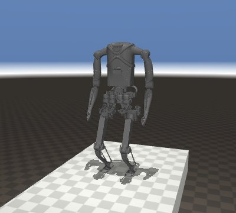
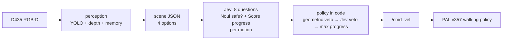

# Kangaroo × Jev: reactive navigation with a System One model

Exploratory report · October 2026 · benchmark run `20261010-221313`


## Summary

- **Question.** Can [TypeSafe Jev](https://docs.typesafe.ai), a System One model that returns typed judgments rather than text,
  make the second-by-second decisions of a camera-driven reactive navigator on PAL Robotics' Kangaroo biped?
- **Setup.** Kangaroo (4dof arms) in MuJoCo, walking on PAL's own RL locomotion policy. A head RGB-D camera, four discrete
  motions, one decision per second, and a red goal cube that is in view from the start. No map, no planner, no pose for the
  decision maker. A short hand-written rule over the same inputs is the baseline.
- **Result.** In 12 episodes (6 courses × 2 decision makers) nobody fell and nobody reached the cube within 90 s.
  Jev covered 46% of the start-to-cube distance on average, the baseline 33%; Jev was ahead on 4 of 6 courses.
- **Lessons.**
  1. A single "pick the action" question let Jev walk off every raised edge. Splitting the judgment into a safety `Noul` and a
     progress `Score` per motion, with the safety margin enforced in code, removed the falls.
  2. What is left is the classic local minimum of reactive navigation: both decision makers dither left and right in front of
     walls and edges. Perception and Jev's latency (0.24 s per decision) are not the bottleneck.

## Setup



| Part | Choice |
| --- | --- |
| Robot and simulator | `kangaroo_simulation` pregenerated MJCF `floating_4dof_no-end-effector_fixed`, `mujoco_ros2_control`, ROS 2 Humble |
| Walking | `pal_policy_deployer` loco policy **v357** (4dof baseline, mjlab), `full_body_4dof` PD gains, 50 Hz |
| Camera | Idealized RealSense D435 on the torso colour frame: pinhole RGB-D, 87°×58°, 424×240, 30° down, 5 Hz |
| Perception | YOLO26n-seg (CPU) + depth geometry + red-colour mask, 20 s memory of edges, obstacles and the cube |
| Decision | Jev (`jev-latest`), one request per second; or the rule-based baseline on the same scene |
| Motions | forward 0.5 m/s · turn ±0.7 rad/s on the spot · backward −0.3 m/s; each lasts at most 1 s |



## Courses

Every course starts with the robot at the origin and the cube on a 0.5 m pedestal in view. Raised courses are deck tiles over a
floor 1.5 m below: stepping off is a fall that ends the episode. Walls are 0.8 m, below the camera, so the cube stays visible.

| Course | What makes it hard |
| --- | --- |
| walkway turn | 1.4 m L-shaped walkway; the straight line to the cube crosses the drop |
| narrow bridge | 1 m bridge, offset to the left of the straight line |
| pit | 2×2 m hole between the robot and the cube |
| crowded walkway | 2 m walkway with two people and a block |
| wall gap | wall across the way, 1.2 m gap off to the left |
| staggered walls | weave right, then left |

What the robot's camera sees at the start, with YOLO masks (the cube is found by colour, not by YOLO):


## Decision design

Perception does all the geometry. For each motion it measures, along a robot-wide strip in the direction the robot would face
afterwards, the distance to the nearest obstacle and to where the floor ends, and where the cube would then be:

```json
{
  "goal": {"visible": true, "distance_m": 4.6, "bearing_deg": 33},
  "options": {
    "forward":  {"path_clear_m": 4.0, "floor_ends_m": 4.0, "free_run_m": 4.0, "goal_bearing_after_deg": 33},
    "left":     {"path_clear_m": 4.0, "floor_ends_m": 1.0, "free_run_m": 1.0, "goal_bearing_after_deg": 5},
    "right":    {"path_clear_m": 4.0, "floor_ends_m": 1.0, "free_run_m": 1.0, "goal_bearing_after_deg": 61},
    "backward": {"path_clear_m": 4.0, "floor_ends_m": 4.0, "free_run_m": 4.0}
  },
  "objects": [],
  "recent_actions": ["forward", "left"]
}
```

Jev gets this state plus a short legend of the fields, and answers 8 questions in one request (TypeSafe's speculative fan-out):
for each motion a `Noul` "is it safe to …?" and a 4-level `Score` "how much would it help reach the red cube to …?". The policy
stays in code, so thresholds can change without re-running inference:

1. **Geometric veto.** A motion needs measured room: 0.8 m of free run to walk forward, 0.5 m to turn. Backward only undoes a step
   forward, since the camera cannot see behind.
2. **Jev veto.** An allowed motion is dropped if Jev's p(safe) is below 0.3 (people, odd objects).
3. **Progress.** The highest progress score wins.

The baseline uses the same options and veto: walk forward if the cube is roughly ahead, else turn towards it if that way has 1.5 m of
free run, else keep walking where it is open.

### How the design got here

| Iteration | Courses | Outcome |
| --- | --- | --- |
| One `Choice` picks the motion; goal from the simulator pose | 5 flat courses | Jev reached 1 of 5, baseline 4 of 5. Jev kept walking with an obstacle 0.9 m ahead and walked away from a goal behind it. |
| One `Choice`; goal found by the camera | 6 raised and wall courses | Jev walked off an edge on all 4 raised courses, confidence rising to 0.98 as the edge closed in. 0 of 6 reached. |
| Fan-out of `Noul` + `Score` per motion, policy in code (this report) | 6 courses, goal in view | No falls. 0 of 6 reached; progress 46% vs 33%. |

## Results


- **No falls, one graze.** Jev passed 0.07 m inside the 0.3 m footprint margin of a person on the crowded walkway; every other
  episode kept its margins.
- **Jev is ahead where an open path leads roughly towards the cube**: walkway turn 73% vs 44%, pit 84% vs 41% (below). Its
  progress score was asked to value exactly that, and it turned less often than the baseline on 4 of 6 courses.
- **Both stall at the narrow bridge and the walls** (22–39%). Jev agreed with the baseline on 79–90% of steps.

Best case, the pit: Jev walks round the hole and is 1.7 m from the cube when time runs out; the baseline stalls at the rim (3.9 m).
Frames are re-rendered from the logged base pose (joints at the start posture), with YOLO masks:


## Jev's judgments


Jev's safety answers follow the measured room only roughly: it still calls a quarter of the forward steps without room safe. The
margin belongs in code; Jev's safety answer is useful as an extra veto, not as the only one.


One decision costs about 2,300 input tokens (8 questions; the state is read once), about $0.0001 at $0.042 per million tokens,
with no API errors in 349 requests.

## Failure modes

- **Dithering.** Turns are 62–92% of all decisions, with up to 27 left/right flips in an episode. Near a wall or an edge the
  veto blocks forward, each turn looks best on its own, and nothing records which side was already tried.
  The wall gap shows it: both decision makers swing back and forth in front of the wall.

  
- **Narrow passages.** The bridge is offset from the robot's line, so getting onto it takes a sidestep: turn, walk, turn back.
  Facing the cube, forward runs into the platform edge within 0.8 m and is vetoed; facing the bridge, no single step improves
  the view of the cube. Neither decision maker ever lined up with the bridge.
- **YOLO false positives.** It labels the deck "bed" (0.6–0.7) in some frames, and these go to Jev unchanged. Distances come
  from depth, so a wrong label can only sway Jev's judgments, not the veto.

## Limitations

- One episode per course and decision maker; differences of a few percent are noise.
- The machine was loaded by an unrelated process during the run: perception took 0.4–2.2 s per frame instead of ~0.13 s, so
  episodes got 38–87 decisions instead of ~90. Motions are capped at 1 s of sim time, so this changes the pace, not what a
  decision does.
- Idealized sensing: noise-free pinhole depth, and the simulator's base pose stands in for odometry (used only to keep remembered
  points in place; the decision makers never see it).
- Fixed velocities and four motions; the walking policy (v357) turns at ~28°/s on the spot.

## Next steps

- Add commitment: a `Noul` "is the robot going back and forth without progress?" and a remembered turn direction that code keeps
  until a long free run opens.
- Repeat each course several times with seeds, and report spread.
- Give perception a wider view of the floor (second camera or a lower tilt) so narrow passages are measured earlier.

## Reproduce

```bash
docker compose build
export TYPESAFE_API_KEY=...
docker compose run --rm kangaroo python3 -m kangaroo_jev.bench          # ~30 min, writes results/<run>/
docker compose run --rm kangaroo python3 docs/figures.py results/<run>  # regenerates docs/img/
```

## Integration notes

Upstream code is pinned and not modified; `kangaroo_jev/sim_setup.py` adapts the installed packages at launch.

- **Camera.** The MJCF has the RealSense frames but no camera; one is added on `torso_front_up_rgbd_camera_color_frame` and
  published by the `mujoco_ros2_control` CameraPlugin.
- **Humble.** `kang_mjlab_node` reads robot state from ros2_control's pal_statistics introspection topics, which only exist from
  Jazzy on. `kangaroo_jev/introspection_shim.py` rebuilds them from `/joint_states` and the torso IMU, at 50 Hz sim time and only
  once the RL controller is active (starting earlier knocks the robot over at the handover). Humble's controller_manager also
  needs `~/robot_description` remapped to `/robot_description`.
- **Policies.** On the lower-body model the launch default (v315) balances but never steps, also in plain MuJoCo on pal_mjlab's
  training XML; the newer forward/backward policies walk. On the 4dof model, v357 was the best all-round policy in a MuJoCo sweep
  of v265, v352–v357 and v700.
- **Perception.** The floor plane is fitted to the bottom of every frame: a few degrees of torso pitch otherwise turn far floor
  into phantom obstacles or edges.

## Credits

[PAL Robotics](https://github.com/pal-robotics) (`kangaroo_robot`, `kangaroo_simulation`, `pal_policy_deployer`, `pal_mjlab`),
[mujoco_ros2_control](https://github.com/ros-controls/mujoco_ros2_control), [Ultralytics YOLO](https://github.com/ultralytics/ultralytics)
(the person billboards are a crop of its `bus.jpg` sample, AGPL-3.0), [TypeSafe](https://docs.typesafe.ai).
