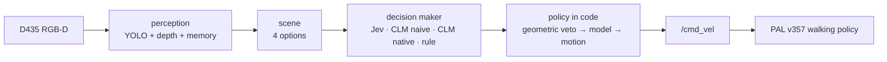
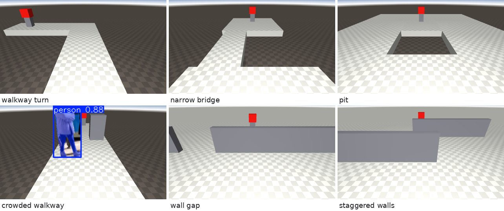
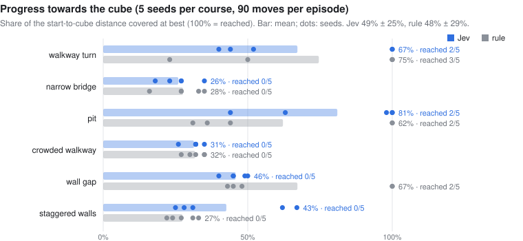
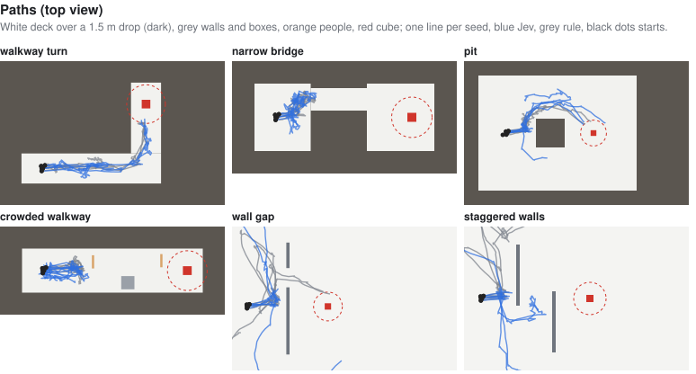
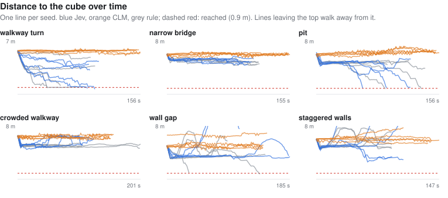
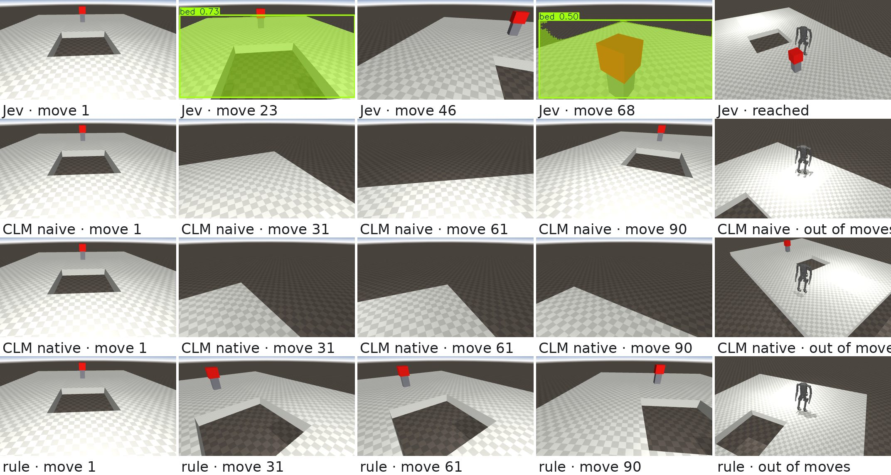
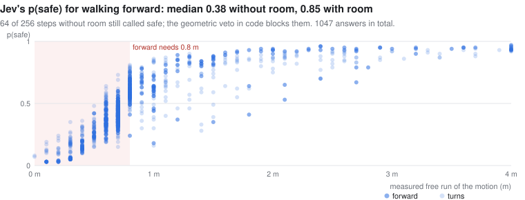
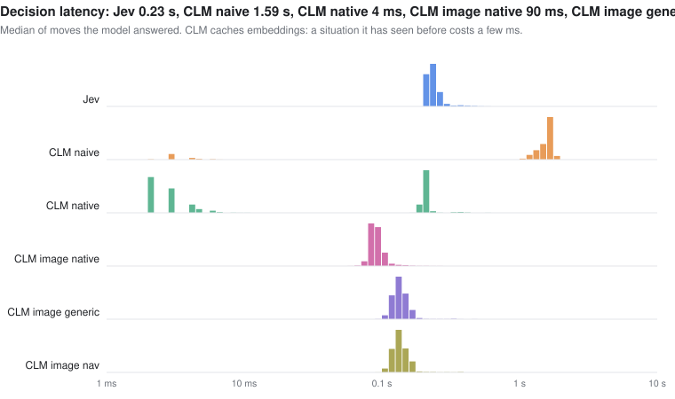
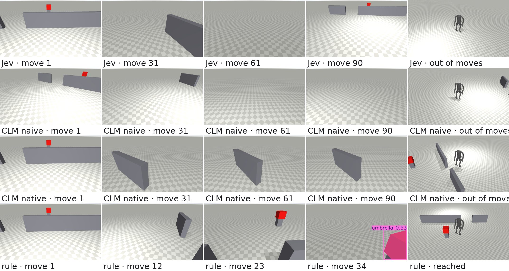

# Kangaroo × System One models: reactive navigation

Exploratory report · October 2026 · 120 episodes (6 courses × 4 decision makers × 5 seeds)


## Summary

- **Question.** Can a System One model, one that returns typed judgments rather than text, make the move-by-move
  decisions of a camera-driven reactive navigator on PAL Robotics' Kangaroo biped?
- **Setup.** Kangaroo (4dof arms) in MuJoCo, walking on PAL's own RL locomotion policy. A head RGB-D camera, four discrete
  motions, and a red goal cube that is in view from the start. No map, no planner, no pose for the decision maker. Four
  decision makers see the same scene and obey the same safety margin in code (see [Decision makers](#decision-makers)):
  TypeSafe **Jev**, **CLM-8B** asked Jev's questions (**CLM naive**), **CLM-8B** asked questions written for it
  (**CLM native**), and a hand-written **rule**.
- **Result.** No falls in 120 episodes.

  | | Jev | CLM naive | CLM native | rule |
  | --- | --- | --- | --- | --- |
  | progress, mean ± sd | **49 ± 25%** | 8 ± 3% | 38 ± 24% | **48 ± 29%** |
  | cube reached | 4 / 30 | 0 / 30 | 2 / 30 | 7 / 30 |
  | decision latency, median | 0.23 s | 1.59 s | 4 ms (0.2 s uncached) | – |

  Jev and the rule are level (+1 pp, 95% CI −9 to +10). Rewriting the questions for CLM lifts it from 8% to 38% (+30 pp in
  all 30 pairs), still 11 pp behind Jev (95% CI +1 to +21). CLM native is the best of all on the walkway turn (90%) and
  the weakest around the pit.
- **Lessons.**
  1. Safety has to be split from progress. A single "pick the action" question let Jev walk off every raised edge. A safety
     `Noul` and a progress `Score` per motion, with the margin enforced in code, removed the falls.
  2. The questions have to fit the model. CLM embeds the state and each answer separately, so Jev's eight questions,
     which share one long state and differ in one line, give it nothing to tell the motions apart: it rated "step
     backwards" best in every decision. One `Choice` whose options carry each motion's consequence in words works.
  3. Jev, CLM native and the rule all end up in the reactive local minimum: 66–80% of their moves are turns, with 18–30
     left–right reversals per episode in front of walls and edges.
  4. Say what to do when the goal is lost. Jev walks away once the cube is out of sight; CLM native, whose wording says
     "the cube is out of sight", turns to search in 672 of 674 such moves.
  5. One episode per course is not enough. An earlier single-seed run had Jev ahead of the rule, 47% vs 33%; across five
     seeds that gap disappears.

## Setup

| Part | Choice |
| --- | --- |
| Robot and simulator | `kangaroo_simulation` pregenerated MJCF `floating_4dof_no-end-effector_fixed`, `mujoco_ros2_control`, ROS 2 Humble |
| Walking | `pal_policy_deployer` loco policy **v357** (4dof baseline, mjlab), `full_body_4dof` PD gains, 50 Hz |
| Camera | Idealized RealSense D435 on the torso colour frame: pinhole RGB-D, 87°×58°, 424×240, 30° down, 5 Hz |
| Perception | YOLO26n-seg (CPU) + depth geometry + red-colour mask, 20 s memory of edges, obstacles and the cube |
| Motions | forward 0.5 m/s · turn ±0.7 rad/s on the spot · backward −0.3 m/s; each lasts at most 1 s |



## Decision makers

All four get the same scene from perception, and code applies the same geometric veto (a motion needs measured room),
so only the choice among the allowed motions differs.

| Name | Model | Questions per move | Runs on |
| --- | --- | --- | --- |
| **Jev** | TypeSafe Jev (`jev-latest`) | [Jev's questions](#jevs-questions): 8, a safety `Noul` + progress `Score` per motion | TypeSafe API |
| **CLM naive** | [CLM-8B](https://github.com/Contrastive-LM/CLM) v0.1 (Qwen3-8B encoder + CLM head) | the same 8, unchanged | local RTX 5060 Ti |
| **CLM native** | CLM-8B v0.1, same server | [CLM-native questions](#clm-native-questions): 1 `Choice` among the allowed motions | local RTX 5060 Ti |
| **rule** | none | hand-written: walk forward if the cube is within 15° ahead; else turn towards it if that way has 1.5 m of free run; else keep walking where it is open; if the cube is unknown, turn left to search | – |

## Experiment

**Episodes.** 6 courses × 4 decision makers × 5 seeds = 120 episodes, each in a fresh simulation.

- **Seed:** jitters the start pose by up to ±0.1 m forward, ±0.15 m sideways and ±6° of heading; seed 0 is the nominal
  start, and the cube stays in view at every start. The simulation is not deterministic either (ROS timing), so the same
  seed does not replay exactly.
- **Start:** the walking policy takes over at about 8 s; driving starts at 15 s.
- **Loop:** perceive → decide → move for at most 1 s, repeated.
- **End:** an episode ends when the robot reaches the cube, falls, or uses up **90 moves**. The budget is in moves, not
  seconds, so a slower decision maker or a busy machine gets the same number of moves.

**Metrics.**

| Metric | Definition |
| --- | --- |
| reached | base within 0.9 m of the cube centre (standing in front of it) |
| progress | (start distance − closest distance) / (start distance − 0.9 m), clipped to 0–100%; 100% = reached |
| fell | base below 0.5 m; *fell off* if it ends below the deck |
| grazed | base within 0.3 m (the robot's footprint) of a wall, box or person |
| turn share, reversals | share of moves that are turns; a left directly after a right, or vice versa |

**Comparison.** Decision makers are paired on the same course and seed. The report gives the mean of the 30 paired
differences in progress with a 95% bootstrap confidence interval.

## Courses

Every course starts with the robot near the origin and the cube on a 0.5 m pedestal in view. Raised courses are deck tiles
over a floor 1.5 m below: stepping off is a fall that ends the episode. Walls are 0.8 m, below the camera, so the cube stays
visible over them.

| Course | What makes it hard |
| --- | --- |
| walkway turn | 1.4 m L-shaped walkway; the straight line to the cube crosses the drop |
| narrow bridge | 1 m bridge, offset to the left of the straight line |
| pit | 2×2 m hole between the robot and the cube |
| crowded walkway | 2 m walkway with two people and a block |
| wall gap | wall across the way, 1.2 m gap off to the left |
| staggered walls | weave right, then left |

What the robot's camera sees at the nominal start, with YOLO masks (the cube is found by colour, not by YOLO):



## Decision design

Perception does all the geometry. For each motion, perception looks along a robot-wide strip in the direction the robot
would face afterwards and measures three things: the distance to the nearest obstacle, the distance to where the floor
ends, and where the cube would then be.

```json
{
  "goal": {"visible": true, "distance_m": 4.6, "bearing_deg": 33},
  "options": {
    "forward":  {"path_clear_m": 4.0, "floor_ends_m": 4.0, "free_run_m": 4.0,
                 "goal_bearing_after_deg": 33},
    "left":     {"path_clear_m": 4.0, "floor_ends_m": 1.0, "free_run_m": 1.0,
                 "goal_bearing_after_deg": 5},
    "right":    {"path_clear_m": 4.0, "floor_ends_m": 1.0, "free_run_m": 1.0,
                 "goal_bearing_after_deg": 61},
    "backward": {"path_clear_m": 4.0, "floor_ends_m": 4.0, "free_run_m": 4.0}
  },
  "objects": [],
  "recent_actions": ["forward", "left"]
}
```

Code always applies the **geometric veto** first: a motion needs measured room, 0.8 m of free run to walk forward and
0.5 m to turn. Backward is allowed only to undo a step forward, since the camera cannot see behind. If nothing is
allowed, code turns towards the side with more room.

### Jev's questions

Used by **Jev** and **CLM naive**. The state is the scene above plus a short legend of its fields (~550 tokens); 8
questions in one request (TypeSafe's speculative fan-out): for each motion a `Noul`, "is it safe to …?", and a 4-level
`Score`, "how much would it help reach the red cube to …?". Then, in code:

1. **Model veto.** An allowed motion is dropped if its p(safe) is below 0.3 (people, odd objects).
2. **Progress.** The highest progress score wins.

### CLM-native questions

Used by **CLM native**. CLM embeds the state and each candidate answer separately and compares them, so everything that
tells the motions apart goes into the answers, and numbers become words. Safety stays entirely in code: only the allowed
motions are offered. One `Choice`, ~50 tokens of state:

```
state:    A walking robot is trying to reach a red cube. The cube is about 6 m away, straight ahead.
          A person is about 2 m away, straight ahead.
question: Which move gets the robot closer to the red cube, or helps it find the cube if it is out of sight?
options:  forward: Walk forward: a long stretch of open floor before something is in the way, and the cube would
                   then be straight ahead.
          left:    Turn left: a short stretch of open floor before the floor ends, and the cube would then be ahead
                   to the right.
          right:   Turn right: a short stretch of open floor before the floor ends, and the cube would then be ahead
                   to the left.
```

Free run becomes "open floor as far as it can see" (4 m), "a long stretch" (2–4 m), "a short stretch" (0.8–2 m) or
"right in front"; the cube's bearing becomes "straight ahead" (< 15°), "ahead to the left/right" (< 60°), "off to the
left/right" (< 120°) or "behind the robot". The motion with the highest probability wins.

### How the design got here

| Iteration | Courses | Outcome |
| --- | --- | --- |
| One `Choice` picks the motion; goal from the simulator pose | 5 flat courses, 1 seed | Jev reached 1 of 5, rule 4 of 5. Jev kept walking with an obstacle 0.9 m ahead and walked away from a goal behind it. |
| One `Choice`; goal found by the camera | 6 raised and wall courses, 1 seed | Jev walked off an edge on all 4 raised courses, its confidence rising to 0.98 as the edge closed in. |
| Fan-out of `Noul` + `Score` per motion, policy in code | same, 1 seed, 90 s | No falls; progress 47% vs 33%. |
| Same design, 5 seeds, 90 moves | same | No falls; Jev 49%, rule 48%. The single-seed lead was noise. |
| CLM-8B on Jev's questions | same | 8%: its answers barely depend on the scene. |
| CLM-native questions, chosen offline (below) | same | CLM 38%. |

## Results

### All decision makers

| | Jev | CLM naive | CLM native | rule |
| --- | --- | --- | --- | --- |
| reached | 4 / 30 | 0 / 30 | 2 / 30 | 7 / 30 |
| fell | 0 | 0 | 0 | 0 |
| grazed | 2 | 0 | 0 | 1 |
| progress, mean ± sd | 49 ± 25% | 8 ± 3% | 38 ± 24% | 48 ± 29% |
| moves: forward / turns / backward | 30% / 66% / 3% | 26% / 48% / 26% | 24% / 76% / 0% | 19% / 80% / 0.5% |
| left–right reversals per episode | 17.8 | 2.6 | 30.2 | 22.1 |
| decision latency, median | 0.23 s | 1.59 s | 4 ms (cached), 0.2 s (new) | – |

| Course | Jev | CLM naive | CLM native | rule | reached, Jev / naive / native / rule |
| --- | --- | --- | --- | --- | --- |
| walkway turn | 67 ± 27% | 7 ± 4% | **90 ± 13%** | 75 ± 32% | 2 / 0 / 2 / 3 |
| narrow bridge | 26 ± 6% | 9 ± 2% | 21 ± 3% | 28 ± 7% | 0 / 0 / 0 / 0 |
| pit | **81 ± 23%** | 6 ± 3% | 26 ± 1% | 62 ± 31% | 2 / 0 / 0 / 2 |
| crowded walkway | 31 ± 3% | 9 ± 1% | 32 ± 3% | 32 ± 3% | 0 / 0 / 0 / 0 |
| wall gap | 46 ± 4% | 11 ± 4% | 38 ± 3% | **67 ± 27%** | 0 / 0 / 0 / 2 |
| staggered walls | **43 ± 18%** | 8 ± 3% | 21 ± 2% | 27 ± 4% | 0 / 0 / 0 / 0 |
| **all** | **49 ± 25%** | **8 ± 3%** | **38 ± 24%** | **48 ± 29%** | **4 / 0 / 2 / 7** |

Progress is the mean ± sd over 5 seeds. Paired differences in progress over the 30 (course, seed) pairs:

| Pair | Mean difference (95% CI) | First ahead / behind / tied |
| --- | --- | --- |
| Jev − rule | +1 pp (−9 to +10) | 14 / 10 / 6 |
| Jev − CLM native | +11 pp (+1 to +21) | 22 / 5 / 3 |
| CLM native − rule | −10 pp (−20 to −1) | 5 / 22 / 3 |
| CLM native − CLM naive | +30 pp (+21 to +39) | 30 / 0 / 0 |
| Jev − CLM naive | +41 pp (+32 to +50) | 30 / 0 / 0 |







- **Single episodes swing widely.** Start changes of at most 0.15 m and 6° move one pair by up to 69 pp (pit, seed 3), and
  on the walkway each decision maker wins some seeds outright. Only the pooled results and the large per-course gaps are
  worth reading.
- **Narrow bridge and crowded walkway stall everyone** at 21–32% on every seed. Here the course limits the outcome, not
  the decision maker.

### Jev and the rule

- **Same average, different style.** Jev walks forward more (30% of moves vs 19%) and reverses direction less. That pays
  off where the open way bends round an obstacle towards the cube, as on the pit (+19 pp) and staggered walls (+15 pp).
- **The rule's stubbornness pays off at the wall gap** (−21 pp). "Keep walking where it is open" carries it along the
  wall to the gap on 2 of 5 seeds. Jev either turns back towards the cube behind the wall or, once it has lost the cube,
  walks away (see [Failure modes](#failure-modes)); it never gets through.

Best case for Jev, the pit (seed 3): Jev walks round the hole and reaches the cube in 68 moves; CLM naive shuffles at the
start; CLM native turns back and forth at the rim; the rule spends its moves at the rim. Frames are re-rendered from the
logged base pose (joints at the start posture), with YOLO masks:



### CLM: naive and native questions

**CLM naive** answers Jev's questions without looking at the scene: across the four motions its p(safe) differs by 0.02
(median; Jev 0.52) and its progress by 0.23 of the 0–3 scale (Jev 1.10). It rates "step backwards" best in all 2,700
decisions, so it undoes 696 of its 709 forward steps; otherwise it mostly turns right. The likely reason: for CLM each
of the 8 questions is the same ~550-token scene with one line naming the motion, which hardly moves its embedding.

**Choosing the native questions offline.** Before any closed-loop run, CLM answered candidate formulations on 213 scenes
logged in Jev's episodes (those with at least one allowed motion). Jev answered the same CLM-native questions as a
control: it shows how much of the decision the wording still carries.

| Decision maker and questions | agrees with the rule | agrees with Jev's own choice | left / right | latency |
| --- | --- | --- | --- | --- |
| random among the allowed motions | 43% | – | – | – |
| CLM, Jev's 8 questions (CLM naive) | 38% | 45% | right-heavy | 1.6 s |
| CLM, a `Noul` per motion, outcome in the question | 54% | 53% | 55 / 100 | 0.39 s |
| **CLM, one `Choice`, outcomes as options (CLM native)** | **60%** | 53% | 85 / 75 | 0.20 s |
| Jev, the same `Choice` (control) | 64% | 73% | 51 / 74 | 0.22 s |
| Jev, the same `Noul`s (control) | 67% | 62% | 67 / 76 | 0.22 s |

The `Choice` won and went into the closed loop.

**CLM native in the closed loop:**

- **It drives.** 38% against 8%, ahead of CLM naive in all 30 pairs; on the walkway turn it is the best of all four (90%,
  2 cubes), and on the crowded walkway level with Jev and the rule.
- **It dithers most.** 30 left–right reversals per episode (pit: 46). The words make the two turns look alike: in 174 of
  the 419 pit decisions where both turns were allowed they describe the same room, and with the cube roughly ahead the
  two options are mirror images ("Turn left: a short stretch of open floor before the floor ends, and the cube would then
  be ahead to the right" against the same with left and right swapped). Nothing in them separates the turns, so it
  alternates. Around the pit it is 55 pp behind Jev.
- **It searches when the cube is lost.** In 674 moves (26%) the cube was neither visible nor remembered; CLM native
  turned on the spot in 672 of them and never walked away.
- **It is fast because the words repeat.** The same situation in words recurs, so CLM's embedding cache answers 58% of
  its decisions in 2–4 ms; a new situation takes about 0.2 s on the 16 GB card.

### CLM with camera images

*Pending.* The improved image CLM from [kangaroo-clm](../kangaroo-clm) (Qwen3-VL-8B encoder, head fine-tuned with camera
frames) will run here with the CLM-native questions and the head-camera frame, on the same 30 episodes.

## Model judgments



These are the safety answers of the two models that answer Jev's questions. Jev's follow the measured room only roughly. With room to walk, the median p(safe) is 0.91; without it,
0.41, and 29% of forward steps without room are still called safe. The margin belongs in code; Jev's safety answer is
useful as an extra veto, not as the only one. CLM calls every step safe (median 0.88 without room, 0.91 with room): its
answer carries no information here, and the veto in code is what kept it from falling.



- **Jev:** one decision costs about 2,300 input tokens (8 questions; the state is read once), about $0.0001 at $0.042
  per million tokens. There were no API errors in 2,615 requests. Jev chose the same motion as the rule on 71% of moves.
- **CLM naive:** 1.6 s median on a 16 GB RTX 5060 Ti, which has to keep 1.5 GB of the Qwen3-8B encoder's weights in CPU
  memory (CLM's README reports up to 9× lower latency than Jev on larger GPUs): 8 states of ~550 tokens per move. No errors
  in 2,700 requests; it chose the rule's motion on 12% of moves.
- **CLM native:** one state of ~50 tokens and 2–4 short options per move: 0.2 s for a new situation, 2–4 ms when the same
  situation in words recurs (58% of moves). No errors; it chose the rule's motion on 58% of moves.

## Failure modes

- **Dithering (Jev, CLM native, rule).** Turns are 66–80% of all moves, with 18–30 left–right reversals per episode.
  Near a wall or an edge the veto blocks forward, each turn looks best on its own, and nothing records which side was
  already tried. CLM native dithers most (see [CLM: naive and native questions](#clm-naive-and-native-questions)).
- **Walking away (Jev).** In 5 of Jev's 10 open-floor episodes (wall gap, staggered walls) the robot ended up more than
  9 m from the cube; the rule never did. In each case the cube was out of view, and usually out of the 20 s memory too.
  The likely cause: Jev's progress `Score` has no level for "cube unknown", so every free step forward rates as progress.
  The rule turns on the spot to search instead, and so does CLM native, whose wording says "the cube is out of sight".
  Wall gap, seed 0: Jev loses the cube behind the wall and walks off; the rule follows the wall to the gap.

  
- **Narrow passages (both).** The bridge is offset from the robot's line, so getting onto it takes a sidestep: turn, walk,
  turn back. Facing the cube, forward runs into the platform edge within 0.8 m and is vetoed. Facing the bridge, no single
  move improves the view of the cube. Neither decision maker ever lined up with the bridge.
- **Grazes.** Three episodes came at most 0.09 m inside the 0.3 m footprint margin: Jev twice on the staggered walls, the
  rule once on the crowded walkway. The base never came closer than 0.21 m to an obstacle. Neither CLM variant grazed.
- **Fallback turn.** When no motion is allowed, code turns towards the side with more room, without asking the model. In
  this benchmark it never caused a fall, but kangaroo-clm's image heads fell off an edge after such a turn: standing
  still or stepping back would be safer.
- **YOLO false positives.** It labels the deck "bed" and a wall end "umbrella" in some frames, and these labels go to Jev
  unchanged. Distances come from depth, so a wrong label can only sway the models' judgments, not the veto.

## Limitations

- Five seeds per course and decision maker, and the seed only jitters the start pose. Per-course spreads are wide (up to
  ±32 pp), so only the pooled comparison and the large per-course gaps carry weight.
- Jev and rule episodes ran two at a time, so perception took 0.1–2.2 s per frame (mean 0.75 s) instead of ~0.13 s. The move budget
  keeps the comparison fair, but the scene a move acts on can be up to about a second old.
- Idealized sensing: noise-free pinhole depth, and the simulator's base pose stands in for odometry. Perception uses the
  pose only to keep remembered points in place; the decision makers never see it.
- Fixed velocities and four motions; the walking policy (v357) turns at ~28°/s on the spot.
- CLM naive was asked questions designed and tuned for Jev. CLM's own README example (an angry customer) gives urgency 0.85 here
  against 0.41 in the README, with a matching encoder setup (Qwen3-8B bf16, last-token pooling, CLM head revision
  `e939398`), so the served head may differ from the one the README was written with.
- The CLM episodes ran one at a time, after the Jev and rule episodes; perception was faster (0.14–0.16 s per frame). The
  move budget makes timing irrelevant to the comparison.
- 14 episodes were restarted (1 Jev, 6 CLM naive, 3 CLM native, 4 rule) because the robot fell during the walking-policy
  handover, before the first move; one CLM native episode fell twice there and was run again.
- The CLM-native wording was chosen on 213 logged scenes against agreement with the rule and with Jev, not tuned in the
  closed loop. Its word bands are coarse by design; finer bands would separate the turns better but do more of the
  reasoning in code.

## Next steps

- **Lost cube.** Give the progress question an explicit answer for "cube neither visible nor remembered" (turn to search),
  or ask a separate `Noul` "is the cube's location known?" and search in code.
- **Commitment.** Ask a `Noul` "is the robot going back and forth without progress?" and keep a remembered turn direction
  in code until a long free run opens.
- **Floor view.** Give perception a wider view of the floor (a second camera or a lower tilt), so narrow passages are
  measured earlier.
- **Variation.** Vary more than the start pose: course geometry, lighting, people's positions.
- **CLM native.** Break the mirror symmetry of the two turns (say which turn faces the cube more directly, or keep a
  remembered turn direction in code), and fine-tune a CLM head on these questions (CLM's `train/finetune.py --task choice`).

## Reproduce

```bash
docker compose --profile clm build
export TYPESAFE_API_KEY=...
OFFLOAD_GB=1.5 docker compose --profile clm up -d clm    # CLM-8B on the GPU; OFFLOAD_GB=0 on cards with 24 GB or more
docker compose run --rm kangaroo python3 -m kangaroo_jev.bench            # 120 episodes, ~5 h, writes results/<run>/
docker compose run --rm kangaroo python3 docs/figures.py results/<run> pit:3 wall_gap:0   # regenerates docs/img/
```

`results/<run>/summary.md` holds the tables above; each episode's `.jsonl` file holds every scene, decision and raw model
answer.

## Integration notes

Upstream code is pinned and not modified; `kangaroo_jev/sim_setup.py` adapts the installed packages at launch.

- **Camera.** The MJCF has the RealSense frames but no camera. One is added on `torso_front_up_rgbd_camera_color_frame`
  and published by the `mujoco_ros2_control` CameraPlugin.
- **Start pose.** The robot always spawns at the world origin, so for a seed the course itself is placed around it. All
  logs and metrics are in the course frame.
- **Humble.**
  - `kang_mjlab_node` reads robot state from ros2_control's pal_statistics introspection topics, which only exist from
    Jazzy on. `kangaroo_jev/introspection_shim.py` rebuilds them from `/joint_states` and the torso IMU, at 50 Hz sim
    time. It starts only once the RL controller is active; starting earlier knocks the robot over at the handover.
  - Humble's controller_manager also needs `~/robot_description` remapped to `/robot_description`.
- **Policies.**
  - Lower-body model: the launch default (v315) balances but never steps, also in plain MuJoCo on pal_mjlab's training
    XML. The newer forward/backward policies walk.
  - 4dof model: v357 was the best all-round policy in a MuJoCo sweep of v265, v352–v357 and v700.
- **CLM.** The `clm` service runs vLLM (Qwen3-8B, last-token pooling, bf16) and `clm-serve`, pinned to CLM commit
  `d5f9ef0`. `kangaroo_jev/brains.py` builds Jev's questions with either SDK's `Noul` and `Score`, so Jev and CLM naive
  receive identical requests; `ClmNativeBrain` holds the CLM-native questions.
- **Perception.** The floor plane is fitted to the bottom of every frame. Without the fit, a few degrees of torso pitch
  turn distant floor into phantom obstacles or edges.

## Credits

[PAL Robotics](https://github.com/pal-robotics) (`kangaroo_robot`, `kangaroo_simulation`, `pal_policy_deployer`, `pal_mjlab`),
[mujoco_ros2_control](https://github.com/ros-controls/mujoco_ros2_control), [Ultralytics YOLO](https://github.com/ultralytics/ultralytics)
(the person billboards are a crop of its `bus.jpg` sample, AGPL-3.0), [TypeSafe](https://docs.typesafe.ai),
[Contrastive-LM CLM](https://github.com/Contrastive-LM/CLM) (Apache-2.0), [vLLM](https://github.com/vllm-project/vllm).
